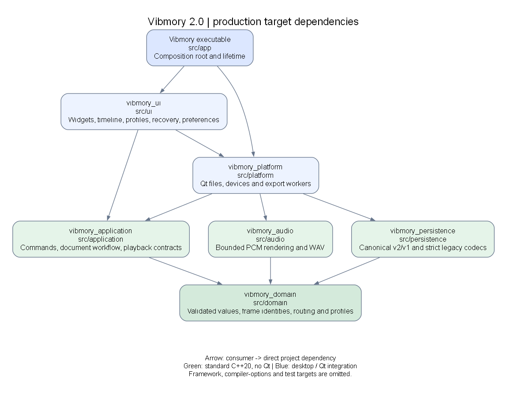

# Vibmory

Vibmory is a Qt 6 desktop editor for patterns played through speakers used as haptic actuators. Each grid cell stores a frequency and signed-PCM peak amplitude for each frame. A project defines sequence timing, physical channel routing, calibration gains, and oscillator phase behavior.

The software was used in [Vibmory - Mapping Episodic Memories to Vibrotactile Patterns](https://dl.acm.org/doi/abs/10.1145/3569009.3572747).

The current implementation is **Vibmory 2.0.0**: a validated C++20 document/editor core, a Qt 6 Widgets desktop shell, streaming audio preview, atomic project/WAV writes, grouped undo/redo, stable frame identities, device profiles, recovery, and English/German presentation preferences. Windows x64 is the packaged desktop target; Linux CI validates the Qt-free core.

## Architecture at a glance



Arrows point from a consumer to its direct project dependency. The four green core libraries build without Qt. The executable constructs the concrete services and supplies them to the editor.

| Target / source directory | Responsibility | Main types or operations |
| --- | --- | --- |
| `Vibmory` / `src/app` | Startup, settings, dependency construction and lifetime | `main.cpp` |
| `vibmory_ui` / `src/ui` | Editor actions and numeric view projections | `EditorWindow`, `GridWidget`, `CellInspector`, `FrameListModel`, `DeviceProfileActions`, `RecoveryController`, `UiPreferences` |
| `vibmory_platform` / `src/platform` | Qt storage/device adapters and export jobs | `QtProjectStore`, `QtAudioBackend`, `QtClock`, `WaveExportJob`, `RecoveryFile` |
| `vibmory_application` / `src/application` | Transactional edits, save policy, playback and replaceable contracts | `EditorSession`, `DocumentWorkflow`, `PlaybackService`, `DocumentStore`, `PlaybackBackend`, `MonotonicClock`, `applyDeviceProfile()` |
| `vibmory_audio` / `src/audio` | Bounded deterministic samples and WAV encoding | `PcmRenderer`, `renderWave()`, `waveHeader()` |
| `vibmory_persistence` / `src/persistence` | Versioned project and strict legacy parsing | `encodeProject()`, `decodeProject()`, `decodeLegacyCsv()` |
| `vibmory_domain` / `src/domain` | Validated numeric values, frame identities, routing and profiles | `PatternDocument`, `DocumentSnapshot`, `DeviceProfile`, `Result` |

`EditorSession` owns the editable document, selection, revision and undo state. Playback, export and recovery receive independent document copies. Painting reads a numeric projection; it never changes selection, document data or playback position. The GUI thread owns mutable editor/Qt objects, while export/recovery workers return results through queued watchers.

See [Architecture](docs/Architecture.md) for state/thread contracts and [Class and lifecycle diagrams](docs/diagrams/ClassDiagram.md) for current ownership, interfaces, adapters, and diagram regeneration instructions.

## Download a Windows executable

A local Qt installation is **not needed** to run the portable build.

1. Open the repository's [Build, test and package workflow](https://github.com/MohammadMokhalled/Vibmory_HapticPatternGenerator/actions/workflows/build.yml).
2. Select a successful run for the branch you want to test.
3. Download the **Vibmory-windows-x64** artifact. GitHub may require sign-in to download artifacts.
4. Run its per-user `Vibmory-windows-x64-setup.exe`, or extract `Vibmory-windows-x64.zip` and launch `Vibmory/Vibmory.exe`. Keep the portable DLLs and plugin folders beside the executable. The installer targets Windows 10 version 1809 or newer, x64, and needs no administrator rights.

The artifact also contains a SHA-256 checksum. CI builds Windows x64 with Qt 6.8.3, runs core and offscreen UI tests, deploys Qt runtime/plugins, and launches the packaged program with Qt removed from PATH. Artifacts are retained for 30 days. Pushes and pull requests produce builds; manual dispatch is available after the workflow is present on the repository's default branch.

Version tags also assemble a verified draft release with portable/setup/source downloads and checksums. See [Releases](docs/Releases.md) for installer lifecycle, optional signing credentials, and the draft review process. Builds are unsigned when no certificate is configured.

The same run supplies **Vibmory-dependency-sources** with matching Qt/FFmpeg sources and upstream software-renderer sources. Keep it with the binary when redistributing. The application uses Qt under LGPLv3 and FFmpeg under LGPLv2.1-or-later; full notices, a hashed runtime inventory, and [library replacement/source instructions](docs/Distribution.md) accompany the package. Vibmory's own code uses [MIT](LICENSE).

```powershell
gh run list --workflow build.yml
gh run download RUN_ID --name Vibmory-windows-x64 --dir artifacts
```

## Edit and test a pattern

- **File > New project** creates a grid with named rows and columns.
- Select a cell with the mouse or arrow keys, then set frequency in Hz and amplitude from 0 to 32767. Escape clears selection. Zero frequency produces silence.
- Add/duplicate/delete frames, move them earlier/later, or drag them between rows in the thumbnail timeline. Undo/redo applies to document changes, including reordering, routing, and settings. Frame identity and selection follow the moved frame.
- The final frame cannot be deleted. Move actions are disabled at sequence boundaries; a failed edit leaves the document and timeline unchanged.
- Set frame rate, total duration, sample rate, and phase policy. The sequence repeats for the specified total duration; duration is not a repeat count.
- **Edit > Channel routing and gains** maps each physical output channel to a logical cell. New documents use row-major order. Gains are multiplicative values between 0 and 1.
- **Edit > Save/Load device profile** reuses a grid's channel map and calibration gains across projects. Loading shows a review and keeps the current output device unless you explicitly select the profile's available device. See [Device profiles](docs/DeviceProfiles.md).
- Select a compatible output device and press **Play**. Playback streams a fixed snapshot; editing is locked until Stop/completion. The exact channel count/sample rate must be supported; channels are never silently downmixed.
- **File > Export WAV** renders the same snapshot to a valid multichannel WAV without requiring an audio device. Export runs in the background, reports progress, and can be canceled.
- Save a `.vibmory` project to preserve all reproducible settings. Save/close failures preserve the working document; ordinary saves and WAV exports publish only after successful completion.
- Unsaved changes receive a separate recovery snapshot every 30 seconds. After an abnormal exit, startup offers Restore, Discard, or Keep. Restored work remains unsaved. See [Recovery](docs/Recovery.md) for retention and lifecycle behavior.
- **View** selects System/Light/Dark themes and the language for the next launch (English/German/System). These preferences do not change the project. See [Appearance and language](docs/AppearanceAndLanguage.md).

A 2x3 grid requires six physical output channels for preview. A stereo device can preview a 1x2 grid. A larger project can still be exported on a machine without a matching audio device. Actual physical actuator/channel routing and latency must be verified on the intended device; CI uses fake audio and does not exercise physical outputs.

## Project and legacy formats

New `.vibmory` files use the bounded, versioned [project format](docs/ProjectFormat.md). Version 2 stores every cell, stable frame identities and ordering, frame rate, duration, sample rate, phase mode, channel permutation, and gains. Version 1 projects remain readable and are upgraded when saved. Device identity is machine-specific and is not stored in a project.

Use **File > Import legacy CSV** for old files. The original writer used `frame count, rows, columns`, while the original loader interpreted dimensions differently. Import requires an explicit orientation rather than silently transposing rectangular grids. Legacy imports retain column-major physical channel routing and the legacy absolute-phase policy. Save imported documents as `.vibmory` to make these choices explicit.

## Build locally

Requirements for the desktop build:

- CMake 3.24+, Ninja, and a C++20 compiler.
- Qt 6.8+ with Core, Gui, Widgets, Concurrent, Multimedia, LinguistTools, and Qt Test when testing is enabled. CI pins Qt 6.8.3's `msvc2022_64` package and uses the Windows 2025 hosted MSVC x64 toolchain.
- A matching compiler/architecture for Qt's binaries. On Windows, use a developer command prompt and set `CMAKE_PREFIX_PATH` to the Qt compiler-specific installation directory.

```powershell
cmake --preset desktop
cmake --build --preset desktop
ctest --preset desktop
cmake --install out/desktop --prefix "$PWD/stage/Vibmory"
```

Run `out/desktop/Vibmory.exe` or the deployed `stage/Vibmory/Vibmory.exe`. An optional positional argument opens a `.vibmory` project. `--smoke-test` starts the complete UI and exits without audio.

```powershell
./stage/Vibmory/Vibmory.exe ./my-pattern.vibmory
./stage/Vibmory/Vibmory.exe --theme dark --language de
./stage/Vibmory/Vibmory.exe --smoke-test
./stage/Vibmory/Vibmory.exe --screenshot ./editor.png --theme light --language en
```

`--no-recovery` disables recovery snapshots and startup prompts for that launch. Theme/language overrides do not write preferences. Smoke-test and screenshot modes isolate preferences in a temporary directory and disable recovery.

The pure C++ domain, editor, codec, and renderer can be built **without Qt or downloaded dependencies**:

```powershell
cmake --preset core
cmake --build --preset core
ctest --preset core
```

On Windows these Ninja presets require a compiler developer environment. A plain PowerShell alternative with an installed Visual Studio toolchain is:

```powershell
cmake -S . -B out/core-vs -DVIBMORY_BUILD_GUI=OFF -DVIBMORY_WARNINGS_AS_ERRORS=ON
cmake --build out/core-vs --config Debug
ctest --test-dir out/core-vs -C Debug --output-on-failure
```

On Linux, `cmake --preset sanitized`, `cmake --build --preset sanitized`, and `ctest --preset sanitized` enable AddressSanitizer/UndefinedBehaviorSanitizer. Set `BUILD_TESTING=OFF` to omit test targets entirely. The core uses a small dependency-free test runner registered with CTest; UI tests use Qt Test.

Python 3.12+ enables the additional independent WAV, distribution, and release-tool checks. Graphviz is only needed to regenerate the maintained diagrams; it is not a desktop/core build dependency.

## Architecture and contribution

Read [Architecture](docs/Architecture.md), [Class and lifecycle diagrams](docs/diagrams/ClassDiagram.md), [Project format](docs/ProjectFormat.md), [the original refactoring audit](TodoPlanning/RefactoringAudit.md), and [the implementation tracker](TodoPlanning/ImplementationTracker.md).

See [Contributing](CONTRIBUTING.md) for naming, units, thread/error contracts, validation, and dependency/review guidance, and [Completion audit](TodoPlanning/CompletionAudit.md) for the requirement-by-requirement evidence.

Keep document rules in `domain`, editor/playback coordination in `application`, numeric audio rendering in `audio`, codecs in `persistence`, Qt adapters in `platform`, and widgets in `ui`. `app/main.cpp` owns and wires the desktop lifetime. No worker reads a mutable editor session and painting never advances playback.

Use clang-format 21.1.0 for project C++; keep semantic changes separate from large mechanical changes. Add behavioral regressions for changed invariants and error paths. Do not silently change channel order, file interpretation, timing, or waveform semantics in a cleanup commit.

Run `python tools/check_quality.py` to check formatting and module boundaries. If Doxygen is installed when configuring, `cmake --build out/core-preset --target docs` generates API/architecture HTML beneath the build directory. The Linux CI job verifies this target.

Install `clang-tidy==21.1.0` and run `python tools/run_static_analysis.py out/core-preset` after configuring a Ninja preset to analyze the core. The Visual Studio project generator does not produce the compilation database this command needs. CI pins both LLVM tools to 21.1.0 rather than relying on different OS defaults.

Diagnostic categories are `vibmory.storage`, `vibmory.export`, `vibmory.ui`, and `vibmory.recovery`. Set `QT_LOGGING_TO_CONSOLE=1` and capture standard error when investigating a failure. Normal playback does not log every sample, repaint, or mouse action.

The `codec_properties` test runs 500 generated complete round trips and 10,000 reproducible parser mutations. `independent_wave_decode` uses Python 3.12+ to independently verify mono, stereo, and multichannel exports. CI also runs the editor's save/open/export workflow against the deployed runtime without developer Qt paths. For an informational renderer benchmark, configure with `VIBMORY_BUILD_BENCHMARKS=ON` and run `vibmory_render_benchmark`; speed is not a hardware-independent pass/fail gate.

Current limits: 256 logical cells/channels, 1024 frames, 262144 stored cells, 16 MiB project input, 512 MiB rendered PCM, 1-240 frames/s, 1 ms-10 minutes, 8-192 kHz sample rate, and frequencies strictly below Nyquist (also capped at 22000 Hz). These are allocation/output budgets, not a claim that an audio device supports every configuration.

See [third-party notices](THIRD_PARTY_NOTICES.md) for retained Qt example attribution and dependency information.
