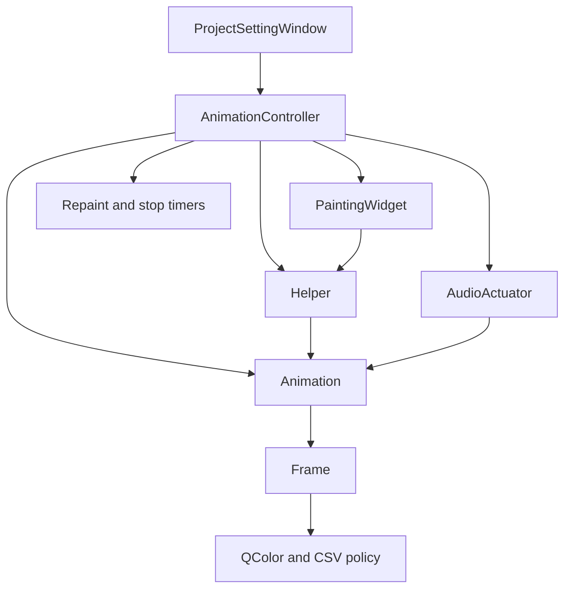
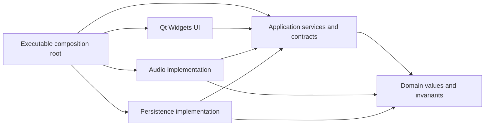

# Vibmory refactoring audit and implementation plan

Audit date: **2026-10-22**. Source snapshot: **`06b6695`** (`add class diagram (#24)`).

This is a source-based review and a proposed backlog, not an implementation report. Application code was not changed. The goal is a small, understandable, dependable Qt application whose architecture makes incorrect behavior difficult to introduce. More layers, files, interfaces, or design patterns do not automatically make this project cleaner.

## 1. Executive assessment

The main problem is the absence of clear ownership and state boundaries. `Animation` combines document data, editor selection, persistence, synchronization, and presentation colors. `AnimationController` constructs the document, audio backend, drawing helper, widget, and timers. `Helper` draws the grid, owns selection, and advances animation frames during painting. `ProjectSettingWindow` coordinates all of these indirectly while maintaining another copy of some state.

Several issues are correctness defects, not matters of taste:

- Opening a project can read an uninitialized controller pointer because member declaration order differs from the apparent initializer order.
- A loaded animation has an uninitialized current-frame index.
- Rows and columns have inconsistent meanings across creation, drawing, selection, and persistence. A rectangular project cannot reliably round-trip through the existing writer and reader.
- Frame tabs and document frames can diverge during duplication, deletion, and dragging.
- Generating audio writes a different path from the path that the Play button checks. The generated `.wav` file contains raw samples rather than a WAV container.
- Painting advances playback, so window-system repaint behavior affects the sequence.
- Save, generation, and playback operations can report or imply success after failure.
- The build advertises Qt 5 and Qt 6 while the audio implementation uses Qt 5 APIs. The required GoogleTest source directory is absent from this checkout.

**Recommendation:** fix the correctness and build foundation first, introduce a few enforceable module boundaries second, then finish conventions, documentation, packaging, and UI polish. Keep Qt Widgets. A frontend rewrite would add migration risk without addressing these defects by itself.

### Priority and rating legend

| Priority | Requirement | Meaning | Scheduling rule |
| --- | --- | --- | --- |
| **P0** | **MUST** | Current correctness/build blocker or plausible crash/data-loss path | Fix in the first implementation wave, with focused regression coverage |
| **P1** | **MUST** | Architectural foundation or essential reliability work for this refactor | Required before calling the refactor complete |
| **P2** | **SHOULD** | Maintainability, consistency, delivery, and usability refinement | Complete for the requested polished project; may follow the structural work |
| **P3** | **OPTIONAL** | New capability or optimization without a demonstrated present need | Defer unless a real requirement justifies it |

The backlog contains **69 items: 11 P0, 31 P1, 18 P2, and 9 P3**. That means **42 required items**, **18 recommended refinements**, and **9 optional extensions**. Items overlap in implementation scope; these counts are not separate-project or effort estimates.

Each backlog item lists **priority / impact / effort / evidence**. Impact ranges from **1/5** (local polish) to **5/5** (application-wide correctness or a critical boundary). Effort is relative: **S** = localized; **M** = several cooperating files; **L** = cross-module work. These are planning sizes, not elapsed-time promises.

Evidence labels: **C** = directly confirmed in source/configuration; **R** = source-supported risk whose precise runtime manifestation needs a Qt integration test; **A** = architectural assessment or proposed improvement. A source-confirmed issue is not a claim that the application was successfully built and reproduced here.

### Review scope and verification limits

Reviewed all 10 implementation files, 10 headers, 3 test implementation files, 3 Designer forms, both CMake files, both CSV fixtures, README, diagram source, formatting/ignore/submodule configuration, and relevant active Doxygen settings. The C++ files total **2,492 lines**; there are **21 existing GoogleTest cases**. `TodoPlanning/` was empty before this report. There is no checked-in CI workflow in this snapshot.

Checks performed:

| Check | Result | Interpretation |
| --- | --- | --- |
| CMake configure in an isolated temporary directory | CMake 4.2.3 detected MSVC 19.50, then stopped at `CMakeLists.txt:17`: no Qt package configuration found | Build and runtime tests were **not run**; this does not establish that Qt is absent everywhere on the machine |
| GoogleTest dependency inspection | `tests/googletest` does not exist; no corresponding tracked gitlink was listed | Independent dependency/setup defect; configure did not reach this stage because Qt discovery failed first |
| `clang-format --dry-run --Werror` against project C++ files | **20 of 23 files require changes** under the existing `.clang-format` | Formatting drift is measured; no files were reformatted |
| Isolated compiler probe of the project-window member-order pattern | Clang emitted `-Wreorder-ctor` and `-Wuninitialized` | Confirms the language-level initialization problem; this probe did not compile or run the Qt application |
| Formula/serialization inspection | Writer/reader dimension mismatch and sample-division edge cases confirmed | Small independent reasoning probes, not application regression-test results |

Source references below use snapshot-relative `path:line` locations. They are anchors for starting the change and will move during implementation. External references are listed in section 12 and linked next to claims that depend on library behavior.

## 2. Current architecture and failure boundaries

| Component | Responsibilities currently combined | Consequence |
| --- | --- | --- |
| `Frame` | Cell storage, CSV parsing/formatting, range assumptions, cached `QColor` values | Persistence and painting policy contaminate the data model; three parallel matrices must agree |
| `Animation` | Frames, selected frame, document loading/saving, partial locking, error flag | A document cannot be used independently of editor state and I/O assumptions |
| `AnimationController` | Concrete object construction, commands, widget ownership, audio, repaint/stop timers | Difficult to test without Widgets/Multimedia; ownership and error propagation are unclear |
| `AudioActuator` | Mutable document access, synthesis, temporary storage, file export, device playback | Cannot test samples independently; export settings and playback data can become stale |
| `Helper` | Painting, geometry, hit testing, selection, playback cursor, locking | Repaint count changes document state; coordinates are transposed |
| `PaintingWidget` | QWidget event handling plus timer/sender assumptions | Rendering is tied to a particular signal source and periodic polling |
| `ProjectSettingWindow` | UI construction, selection synchronization, frame list management, dialogs, navigation, playback state | Model/UI operations have unsafe ordering; text and initialization-event counts stand in for explicit state |
| Startup/create windows | Navigation, top-level-window lifetime, project construction | Inconsistent parents, hidden windows, and unmanaged allocations |
| Build/test setup | One object collection for nearly everything | Domain tests bring in Widgets and Multimedia; dependency requirements are duplicated |

Current dependency shape:



The critical coupling is behavioral: painting mutates the same current-frame index that editing uses, while audio samples are generated separately from live data. Moving these classes into new folders alone would preserve the problem.

## 3. Recommended target architecture

Use a small layered structure with ordinary constructor injection. Keep the data model compatible with Qt Core where that reduces friction; removing every Qt value type is optional. Keep QWidget, QPainter, QColor, audio-device objects, and file dialogs out of the domain.

| Module/target | Owns | Must not own |
| --- | --- | --- |
| `vibmory_domain` | Grid dimensions, cell stimulus values, frames, document invariants, validated playback settings | Widgets, colors, file paths, audio devices, timers, selected UI cell |
| `vibmory_application` | Editor session, selection, document revision/dirty state, frame commands, playback/export coordination, small boundary contracts | QWidget construction, PCM device details, CSV tokenization |
| `vibmory_audio` | Deterministic sample renderer, audio format/channel map, WAV writer, Qt playback adapter | Mutable editor selection, dialogs, widget pointers |
| `vibmory_persistence` | Project codec, legacy CSV import, validated transactional load/save | Current tab, selected cell, drawing |
| `vibmory_ui` | Windows/dialogs, frame list, cell inspector, grid geometry/rendering, presentation messages | File-format parsing, signal synthesis, independent copies of authoritative document state |
| `Vibmory` executable | `QApplication`, factories/composition root, top-level lifetime | Business rules hidden in startup code |

The application depends on domain types and narrow contracts for operations it coordinates. Audio/persistence implementations satisfy those contracts; the executable supplies concrete implementations. Do not make the application link to concrete UI/audio implementations to construct them internally.



Illustrative organization; names can be adjusted consistently during implementation:

```text
src/
  app/main.cpp
  domain/                 # CellStimulus, GridShape, Frame, PatternDocument
  application/            # EditorSession, commands, playback state, contracts
  audio/                  # PcmRenderer, WaveWriter, QtAudioPlayback
  persistence/            # ProjectCodec, LegacyCsvReader, ProjectStore
  ui/
    windows/              # WelcomeWindow, ProjectEditorWindow
    dialogs/              # NewProjectDialog
    widgets/              # GridWidget, CellInspector, frame selector
    rendering/            # GridGeometry, CellColorMap if separation earns its keep
ui/                       # Designer files, or colocated with their widgets
tests/
  domain/
  application/
  audio/
  persistence/
  ui/
  resources/
cmake/
docs/
  architecture/
  decisions/
TodoPlanning/
```

Do not duplicate headers between a global `include/` tree and internal module directories without a reason. Use target-scoped include paths; introduce a public `include/vibmory/` API only if something actually consumes the project as a library.

### Authoritative state and invariants

- **Document:** positive bounded rows/columns; frames all have the same shape; at least one frame unless an explicit empty-document design is chosen; validated frequency/amplitude; persisted settings; a revision.
- **Editor session:** selected frame and optional selected cell. Selection is valid or absent, and it does not belong to the renderer.
- **Playback session:** explicit state, an immutable document/settings snapshot, rendered revision, output format/channel map, and a separate playback cursor.
- **View:** derives enabled states, labels, and displayed values from those owners. A repaint never changes them.
- **Coordinates:** `column == x`, `row == y`, `QSize(columns, rows)`, and row-major logical indexing. Audio routing must be explicit and tested; changing the current x-major output order can change physical wiring expectations.
- **Failure:** loading creates a complete valid document or an error; saving replaces the destination only after success; failure does not advance the UI into a success state.
- **Threads:** editable state and widgets remain on the GUI thread. Workers receive immutable snapshots and return results through queued delivery. Never hold UI/model locks in an audio callback.

## 4. P0 backlog: fix the foundation first

### R01 — Eliminate project-window initialization undefined behavior

**P0 / MUST / impact 5/5 / effort S / evidence C**

- **Evidence:** `include/projectsettingwindow.h:105-108` declares `mSize` before `mAnimationController`. The file-loading constructor at `src/projectsettingwindow.cpp:28-32` initializes `mSize` by dereferencing that pointer. C++ initializes members in declaration order, so listing the controller first does not help. See [Microsoft's member-order warning documentation](https://learn.microsoft.com/en-us/cpp/error-messages/compiler-warnings/c5038?view=msvc-170).
- **Change:** remove the duplicated size member or initialize it only after a valid controller/session exists. Put initializer lists in declaration order. Initialize every member in every supported constructor. The size constructor also leaves `mTabChangeTries` uninitialized; the parent-only constructor creates an editor without a controller.
- **Done when:** create/open paths construct valid editors without initialization warnings; no public constructor leaves connected slots able to dereference an absent session. Delete the unusable constructor if it has no legitimate purpose.

### R02 — Initialize a loaded document's current frame

**P0 / MUST / impact 5/5 / effort S / evidence C**

- **Evidence:** `src/animation.cpp:14-49` initializes `mCreationError`, but not `mCurrentFrame`; multiple getters and edits index through it. `mCurrentPos` is also inconsistently initialized, although `QPoint` itself has a default constructor and this member appears unused.
- **Change:** use default member initialization and one valid construction path. Loading must select frame zero only after validating that at least one frame exists. Ultimately move editor selection out of `Animation` under R18.
- **Done when:** a freshly loaded document can immediately read/edit/duplicate its first frame deterministically, including without a window first selecting a tab.

### R03 — Establish one grid-coordinate convention end to end

**P0 / MUST / impact 5/5 / effort M / evidence C**

- **Evidence:** `src/createprojectwindow.cpp:18-19` passes `(rows, columns)` to `QSize`; `src/animation.cpp:120` writes `(frameCount, height, width)`, but lines 31-32 read the latter fields as `(width, height)`. `src/helper.cpp:33-43,49-57,89-91,106-107` swaps dimensions and coordinates in geometry, rendering, and hit testing.
- **Change:** introduce named rows/columns and explicit conversion helpers. Fix creation, cell rectangles, selection borders, hit testing, import/export, and channel mapping together. Document the legacy CSV header order and hardware channel-order compatibility before migration.
- **Done when:** 2x3 and 3x2 projects with distinct values in every cell create, edit, save, reload, render, and route to the expected channel without transposition. Square grids are insufficient evidence.

### R04 — Enforce document, frame, and numeric invariants at the boundary

**P0 / MUST / impact 5/5 / effort M / evidence C**

- **Evidence:** `Frame` resizes from unchecked dimensions (`src/frame.cpp:4-24`); loaders ignore conversion success (`src/animation.cpp:31-32`, `src/frame.cpp:74-75`); `selectFrame()` assigns unchecked indexes (`src/animation.cpp:63-67`); removing the last frame assigns `-1` into a `quint16` (`src/animation.cpp:163-171`). Audio assumes nonempty frames and nonzero rates.
- **Change:** validate positive dimensions, checked cell/frame/sample/byte counts, index bounds, nonempty documents, amplitude/frequency ranges, frame rate, duration, and sample rate before allocation or mutation. Reject invalid text, negatives, overflow, extra/truncated content, and unsupported settings explicitly. Do not rely on spin-box limits to protect model APIs or imported files.
- **Done when:** invalid input cannot construct a half-valid object, index a nonexistent frame, cause division by zero, wrap an index, or request unbounded allocation/output. Define whether frequency zero means silence or is a valid stored value; keep UI and domain consistent.

### R05 — Make frame edits transactional across the model and selector

**P0 / MUST / impact 5/5 / effort M / evidence C + R**

- **Evidence:** duplication appends a UI tab near the end (`src/projectsettingwindow.cpp:291-296`) but inserts model data immediately after the selected frame (`src/animation.cpp:57-60`). Deletion removes the tab before the model frame (`src/projectsettingwindow.cpp:299-304`), allowing a synchronous `currentChanged` handler to change which model frame is deleted. The exact deletion sequence needs Qt integration coverage.
- **Change:** capture the intended frame identity/index, execute one validated model command, then update the selector from the result with controlled selection signals. Derive labels/order from model state. Explicitly dispose of removed page widgets if tabs remain; `removeTab()` alone does not express ownership cleanup.
- **Done when:** duplicating a middle frame and deleting first/middle/last frames preserve the expected content and selection. The last remaining frame cannot be deleted under the proposed invariant. Failed commands leave both model and view unchanged.

### R06 — Resolve unsupported frame-tab dragging

**P0 / MUST / impact 4/5 / effort S initially / evidence C**

- **Evidence:** `ui/projectsettingwindow.ui:189` enables movable tabs; no `tabMoved` handler reorders `mFrames`. Frame selection is by the new tab position, not a stable identity.
- **Change:** disable dragging immediately. Re-enable only with a document move command, synchronized selector updates, and appropriate persistence/playback order tests. Keep the synthetic add-frame control out of reorderable frame data.
- **Done when:** the displayed sequence always matches the stored and rendered sequence, including after attempted dragging.

### R07 — Repair the generated-audio/Play contract

**P0 / MUST / impact 5/5 / effort M / evidence C**

- **Evidence:** Play checks working-directory `file.wav` (`src/projectsettingwindow.cpp:124`), Generate passes that name (`:320-321`), `prepareActuator()` ignores it (`src/animationcontroller.cpp:119-121`), and `generateFile()` writes the fixed temporary `animation.wav` regardless of its argument (`src/audioactuator.cpp:9,22-30`). The existence condition also accepts a directory with the expected name.
- **Change:** remove guessed paths and filesystem existence as readiness state. Return an owned prepared-audio artifact/result with an actual path or device, settings, format, and revision. Split preview preparation from explicit user-directed export. Decide whether Play prepares automatically or requires a successful Prepare action.
- **Done when:** Generate/Prepare followed by Play works without an unrelated file in the current directory; no directory/stale/unrelated file can unlock playback; the requested export destination is honored.

### R08 — Make project saves atomic and failure-aware

**P0 / MUST / impact 5/5 / effort M / evidence C**

- **Evidence:** `Animation::writeInFile()` writes directly to the destination and checks only open success (`src/animation.cpp:112-126`). `AnimationController::saveToFile()` discards the result (`src/animationcontroller.cpp:104-106`), and the UI never reports write failure.
- **Change:** move saving into persistence, write through `QSaveFile`, inspect serialization/stream errors, and require successful `commit()`. Preserve the old document and dirty state on failure; return a meaningful error with path/context. Keep direct-write fallback disabled if preserving an existing file is required. See [Qt's QSaveFile contract](https://doc.qt.io/qt-6/qsavefile.html).
- **Done when:** unwritable destinations and simulated write/commit failures produce a useful UI error and preserve the previous file. Cancellation produces no error or partial file.

### R09 — Stop reporting successful audio work after failure

**P0 / MUST / impact 5/5 / effort M / evidence C**

- **Evidence:** `generateFile()` returns true even if open fails (`src/audioactuator.cpp:31-40`); `writeData()` and `writeHeader()` never inspect stream status; `play()` ignores file-open failure and continues after an unsupported-format warning (`:63-86`). Callers ignore prepare/play results.
- **Change:** propagate generation, file, device-format, startup, and asynchronous backend errors through one result/error boundary. Enter Playing only after the backend accepts startup; stop/reset resources after failure.
- **Done when:** failed preparation, missing files, unsupported devices, startup errors, and playback interruption restore a coherent stopped/error UI and never claim success.

### R10 — Separate raw PCM preview data from valid WAV export

**P0 / MUST / impact 4/5 / effort M / evidence C**

- **Evidence:** `generateFile()` calls only `writeData()` (`src/audioactuator.cpp:36`); `writeHeader()` is unused. The unused header computes the RIFF size as total bytes rather than total minus eight (`:101-102`) and writes the `data` identifier using untyped character insertions (`:129`), which are unsuitable for guaranteeing four raw bytes.
- **Change:** retain headerless PCM for a raw-audio sink; create a separate WAV writer for exported files. Write exact FOURCC bytes, checked little-endian lengths, channel/sample format, block alignment, byte rate, and data bytes. Define handling of multichannel WAV metadata and the classic RIFF size limit. Do not send a WAV header to a raw PCM sink as audio samples. See [Microsoft's RIFF structure](https://learn.microsoft.com/en-us/windows/win32/xaudio2/resource-interchange-file-format--riff-).
- **Done when:** an independent WAV reader opens an exported file and verifies duration, channel count, samples, and exact chunk sizes; raw preview starts at the first sample without header noise.

### R11 — Make supported Qt versions and dependencies truthful

**P0 / MUST / impact 5/5 / effort M / evidence C**

- **Evidence:** `CMakeLists.txt:17-18` selects Qt 6 or Qt 5; `src/audioactuator.cpp:72-85` uses Qt 5-era `QAudioFormat` setters, `QAudioDeviceInfo`, and `QAudioOutput` raw playback. In Qt 6, raw sample output is provided by [QAudioSink](https://doc.qt.io/qt-6/qaudiosink.html); [QAudioOutput](https://doc.qt.io/qt-6/qaudiooutput.html) serves media-player/capture output. `tests/CMakeLists.txt:4` requires a missing `googletest` directory.
- **Change:** choose and document one tested Qt baseline. Prefer a Qt 6-only target if deployment/device requirements permit; use `QAudioSink`, `QAudioDevice`/`QMediaDevices`, and the matching format API. If Qt 5 support is genuinely required, isolate adapters and test both; a package-name selector is insufficient. Repair test dependency provisioning under R37.
- **Done when:** a clean checkout builds and tests using the documented toolchain; every advertised Qt configuration is actually supported. Do not silently select an untested major version.

## 5. P1 backlog: architecture and essential reliability

### R12 — Introduce enforceable module boundaries

**P1 / MUST / impact 5/5 / effort L / evidence A**

- **Evidence:** the object library includes every UI/model/audio implementation (`CMakeLists.txt:26-60`); controller headers include concrete audio and widget implementations (`include/animationcontroller.h:8-11`).
- **Change:** introduce the domain/application/audio/persistence/UI targets described in section 3. Start with the smallest useful dependency graph, and enforce it through target links rather than folder names alone. Limit interfaces to boundaries requiring substitution, such as playback, storage, and a clock where needed.
- **Done when:** domain tests build without Widgets/Multimedia; application tests use fakes without constructing windows; dependencies do not cycle. A change to a Designer form does not require rebuilding domain logic.

### R13 — Make frames and documents data models

**P1 / MUST / impact 5/5 / effort M / evidence C + A**

- **Evidence:** `Frame` stores `QColor` and parses/formats CSV (`include/frame.h:24,45,65,78`); `Animation` loads paths and writes files (`include/animation.h:30,96`).
- **Change:** move parsing/formatting to codecs and color conversion to presentation. Keep frame/document operations concerned with valid stimulus data and frame structure. Remove cached colors unless profiling establishes a need outside the document.
- **Done when:** model tests use numeric values without QColor assertions or disk access; presentation/codec policy can change without modifying frame storage.

### R14 — Make ownership explicit and construction exception-safe

**P1 / MUST / impact 5/5 / effort M / evidence C**

- **Evidence:** `AnimationController` allocates model/audio/helper/widget and has an empty destructor (`src/animationcontroller.cpp:3-38`). `ProjectSettingWindow` allocates an unparented controller and deletes only `ui` (`src/projectsettingwindow.cpp:18-32,109-112`). `AudioActuator` allocates file/output objects without owning cleanup (`src/audioactuator.cpp:17-18`).
- **Change:** draw an ownership map. Use values or `std::unique_ptr` for non-QObjects and a single deliberate owner for QObjects/widgets, typically Qt parenting. Keep borrowed pointers/references visibly non-owning. Construct dependencies at the composition root and avoid leaking earlier allocations when a later constructor throws. Do not combine independent smart-pointer and QObject-parent owners for the same object.
- **Done when:** repeatedly opening/closing/replacing projects releases models, helpers, controllers, files, timers, outputs, and removed selector pages. No timer or callback outlives its view/session.

### R15 — Give polymorphic backend contracts safe destruction

**P1 / MUST / impact 4/5 / effort S / evidence C**

- **Evidence:** `IActuatorController` has virtual operations but no virtual destructor (`include/iactuatorcontroller.h:11-49`), and is stored as an interface pointer.
- **Change:** add a virtual defaulted destructor if destruction through the interface is supported. Refactor the contract around immutable configuration/prepared data and playback lifecycle, rather than mutable setters that can produce partially configured state. Remove the unnecessary `animation.h` dependency.
- **Done when:** a derived fake/backend can be safely owned and destroyed through the contract; stopping/cleanup has a defined idempotent behavior.

### R16 — Define project close, replacement, and application shutdown

**P1 / MUST / impact 5/5 / effort M / evidence C + R**

- **Evidence:** navigation allocates new windows and calls `close()` on old ones (`src/mainwindow.cpp:22-44`, `src/createprojectwindow.cpp:16-21`, `src/projectsettingwindow.cpp:278-282,324-328`). Parenting varies; close does not by itself establish deletion of heap windows. There is no session shutdown path.
- **Change:** keep one clearly owned application shell/editor lifecycle. Stop playback, cancel or join workers, disconnect delivery, release temporary resources, and then destroy the session/view. Specify behavior for canceling new/open and for a failed import. Account for Qt's last-window-close behavior when changing navigation.
- **Done when:** closing while playing/rendering releases resources; creating/importing repeatedly does not accumulate hidden windows or active sessions; failures preserve the working project.

### R17 — Choose one recoverable error model

**P1 / MUST / impact 4/5 / effort M / evidence C**

- **Evidence:** constructors throw after setting error flags (`src/animation.cpp:18-29`, `src/frame.cpp:33-36`); callers also inspect flags that cannot observe a failed construction (`src/animation.cpp:40-44`). Other operations return bool or ignore failure.
- **Change:** use fallible factories/operations returning a small project `Result<T, Error>` or a consistent documented exception boundary. Since this project requests C++20, do not silently require C++23 `std::expected`; use a simple compatible result or explicitly change the language baseline. Remove redundant construction-error flags and unreachable recovery branches.
- **Done when:** every public failure path has an owner, context, and recovery policy; exceptions do not escape Qt slots/event delivery; parsing errors carry file/frame/row/column detail where available.

### R18 — Centralize editor selection and remove sentinel-driven APIs

**P1 / MUST / impact 4/5 / effort M / evidence C + A**

- **Evidence:** current frame is in `Animation` and `ProjectSettingWindow`; selected cell is in `Helper` and there is another window cell member; `QPoint(-1,-1)` means an implicit selection in controller getters (`src/animationcontroller.cpp:124-137`).
- **Change:** introduce an `EditorSession` with one selected frame and an optional cell. Separate explicit document queries from selected-cell queries. Emit selection/frame/document change signals carrying meaningful values. A selection belongs to editing, not painting or audio.
- **Done when:** switching/deleting frames cannot leave invalid selection; no-selection is represented explicitly; the inspector and grid display the same frame/cell without hidden fallback coordinates.

### R19 — Replace button text and boolean fragments with playback state

**P1 / MUST / impact 5/5 / effort M / evidence C**

- **Evidence:** Play/Stop behavior is decided by button text (`src/projectsettingwindow.cpp:134`), with separate helper flags, timers, UI states, and ignored backend results.
- **Change:** introduce a small state machine, for example Idle, Preparing, Ready, Playing, Stopping, Error, with defined legal transitions. Keep settings in one validated value, including explicit duration units and repeat semantics. Bind controls and status to state. Connect stable signals once and make stop timers single-shot where applicable; avoid repeated connect/disconnect as session state.
- **Done when:** double Play, repeated Stop, prepare failure, early audio completion, interruption, and timer completion each leave one coherent state. Translations/label changes cannot alter logic. Stop UI handling runs once per transition.

### R20 — Make painting a side-effect-free projection

**P1 / MUST / impact 5/5 / effort M / evidence C**

- **Evidence:** `Helper::paint()` calls `mAnimation->nextFrame()` (`src/helper.cpp:94-96`). `PaintingWidget::drawBackground()` creates a painter outside paint events and is called during initialization (`src/paintingwidget.cpp:40-45`, `src/projectsettingwindow.cpp:71-72`). QWidget painting must occur in `paintEvent()` or its callees, as specified in [Qt's custom-widget documentation](https://doc.qt.io/qt-6/qwidget.html#paintEvent).
- **Change:** move playback advancement to the playback/application service. Paint an immutable/current view state. Replace out-of-event drawing with `update()`. Use scoped `QPainter` and shared geometry for fill, borders, and hit testing.
- **Done when:** extra paint events, exposure, resize, minimize/restore, and screenshots cannot advance frames or change document values. All widget painting is event-driven and valid.

### R21 — Use one elapsed-time model for audiovisual playback

**P1 / MUST / impact 5/5 / effort M / evidence C + A**

- **Evidence:** visual timing is timer/repaint-count driven (`src/animationcontroller.cpp:81-100`, `src/paintingwidget.cpp:16-19`), while audio is an independently generated stream and the stop timer is a third schedule.
- **Change:** derive the playback frame from elapsed time/sample position and settings. Prefer measured audio progress when available, with a documented monotonic-clock fallback and latency policy. UI timers request updates; they do not establish how many frames elapsed. Keep the pre-play edit selection separate from playback position.
- **Done when:** delayed/coalesced timer events do not slow the animation; a fake clock verifies start, loop, exact stop boundary, interruption, and restoration of editing selection. Measure hardware latency separately rather than claiming sample-perfect visual synchronization.

### R22 — Render immutable snapshots and track preparation validity

**P1 / MUST / impact 5/5 / effort M / evidence C + A**

- **Evidence:** audio retains an `Animation*` and samples its getters (`src/audioactuator.cpp:11-12,139-156`); edits and frame controls remain available during playback; prepared audio has no document/settings revision.
- **Change:** capture document data and settings once for rendering/playback. Tag prepared data with document revision, frame rate, duration/repeats, sample rate, format, and channel map. Invalidate or regenerate when inputs change. Choose and document whether editing is locked during playback or edits affect only a subsequent snapshot.
- **Done when:** editing a cell/frame or changing settings cannot accidentally play old audio against a new visualization; background work never reads mutable editor objects.

### R23 — Prevent view refreshes from editing the document

**P1 / MUST / impact 4/5 / effort M / evidence C + R**

- **Evidence:** selection refresh calls `setValue()` on spin boxes (`src/projectsettingwindow.cpp:93-99`), and value-change handlers write to the selected cell (`:174-195`). Stored frequency defaults to zero, but the UI minimum is one (`ui/projectsettingwindow.ui:359-387`), allowing mismatches and clamped write-back on some selection transitions.
- **Change:** distinguish view refresh from user commands. Use `QSignalBlocker` for programmatic synchronization and one edit path for paired slider/spin-box controls. Ensure domain and widget ranges/defaults agree. Update selection controls from a single view-state function.
- **Done when:** merely selecting a cell/frame or loading a document does not change values/revision/dirty state, including zero and boundary values; one user edit produces one logical command.

### R24 — Remove initialization-event counting and signal-order workarounds

**P1 / MUST / impact 4/5 / effort S / evidence C**

- **Evidence:** `mTabChangeTries` and `mEnableUnselect` infer readiness after more than two tab-change events (`src/projectsettingwindow.cpp:208-224`). The counter is a `quint8` and is not initialized in one constructor.
- **Change:** construct valid session state before wiring interaction, populate views under explicit signal blocking, then connect or enable commands. Initialize the inspector as disabled when no cell is selected. Remove counters and magic thresholds entirely.
- **Done when:** startup does not depend on the number/order of auto-connected signals; creating, loading, replacing, and refreshing a frame selector all produce the same valid selection behavior.

### R25 — Adopt and document a real thread-safety policy

**P1 / MUST / impact 4/5 / effort M / evidence C**

- **Evidence:** `Animation` locks some accessors/mutations but not `getAmplitude`, `getFrequency`, `nextFrame`, `getCurrentFrameIndex`, or frame iteration during save. `Helper` uses manual locks around only some state (`src/helper.cpp:80-118`). This is neither a complete thread-safety guarantee nor a clearly single-threaded model.
- **Change:** keep editable models on the GUI thread and use immutable worker snapshots, then remove unnecessary locks. If shared mutable access remains necessary, specify the full synchronization contract and use RAII locking everywhere required. Document QObject affinity and queued result delivery.
- **Done when:** there is one explainable concurrency design; worker/render callbacks cannot race edits/destruction; no manual lock/unlock pairs or misleading partial-lock guarantee remain.

### R26 — Separate deterministic synthesis from devices and files

**P1 / MUST / impact 5/5 / effort M / evidence C + A**

- **Evidence:** `AudioActuator::writeData()` queries document state inside the sample loop and writes directly to its file stream (`src/audioactuator.cpp:137-160`).
- **Change:** extract a pure/bounded `PcmRenderer` accepting a validated snapshot/settings/channel map and producing sample blocks. Let preview playback and WAV export consume the same renderer. Keep device discovery/start/stop in a Qt adapter and container encoding in `WaveWriter`.
- **Done when:** a tiny known pattern has independently verified samples without a sound device, filesystem, QWidget, or event loop; preview/export agree on sample data and channel ordering.

### R27 — Correct and bound audio timing/arithmetic

**P1 / MUST / impact 5/5 / effort M / evidence C**

- **Evidence:** `frameLen = sampleRate / frameRate` and `x / frameLen` can divide by zero or accumulate timing error (`src/audioactuator.cpp:139-146`). `quint16 frameIndex` truncates large documents; 32-bit products can overflow; unchecked amplitudes narrow to `int16_t` (`:153-155`). The current UI's listed frame rates divide 48,000 evenly, but the public API accepts other values.
- **Change:** use checked 64-bit sizes/positions, validated limits, and a rational/sample-position mapping such as `floor(sampleIndex * fps / sampleRate) % frameCount`, with overflow-safe arithmetic. Define rounding of duration to samples, signed PCM conversion, saturation/rejection, endianness, zero-duration behavior, and representable timer-unit conversions. Validate frequency against the selected sample rate/Nyquist policy so a configurable low sample rate cannot silently alias stored frequencies.
- **Done when:** non-dividing rates, exact frame boundaries, extreme valid values, zero/negative/too-large rates, empty data, and output-size limits are covered by deterministic tests. Invalid configurations fail before rendering.

### R28 — Make device capabilities and physical channel mapping explicit

**P1 / MUST / impact 5/5 / effort M / evidence C + A**

- **Evidence:** channel count is blindly set to `width * height` and the default output is assumed (`src/audioactuator.cpp:69-85`); unsupported formats only warn. The sample loop is column-major, whereas frame storage/CSV are row-major.
- **Change:** define a channel map from cell identity to device channel; preserve/document current wiring compatibility when changing order. Query the chosen device and reject unsupported channel/sample formats with actionable feedback. Do not silently downmix/reorder haptic channels or substitute a nearest format. Set appropriate multichannel WAV metadata where exported routing requires it.
- **Done when:** asymmetric test patterns prove exactly which cell drives each channel; a no-device/stereo-only/unsupported-channel configuration fails cleanly; selected-device disappearance stops the session coherently. Actual hardware remains an integration test requirement.

### R29 — Specify waveform transitions instead of inheriting accidental phase behavior

**P1 / MUST for the behavior decision / impact 4/5 / effort M / evidence C + A**

- **Evidence:** every sample uses `sin(newFrequency * absoluteTime)` (`src/audioactuator.cpp:145-155`), so changing frequency at frame boundaries can create a discontinuity. No phase or transition policy is documented.
- **Change:** define whether frame changes preserve phase, intentionally reset phase, and/or apply an envelope. Prefer an explicit per-channel phase accumulator for continuity if that matches the haptic protocol. Preserve research compatibility through a documented mode if exact legacy waveforms matter. Smoothing is a product/protocol decision, not an automatic cleanup.
- **Done when:** frame-boundary sample tests express the chosen behavior, zero-amplitude behavior is defined, and generated patterns are reproducible from stored settings.

### R30 — Give temporary audio a session-scoped lifetime

**P1 / MUST / impact 4/5 / effort S / evidence C**

- **Evidence:** every session/process writes the same temporary `/animation.wav` (`src/audioactuator.cpp:9,16`), which can overwrite another session's preparation.
- **Change:** use uniquely owned temporary files/directories or an appropriate bounded buffer/device. Keep the prepared artifact alive through playback, close it before replacement, and remove it at session teardown. Never use the working directory as implicit storage.
- **Done when:** two sessions/processes prepare/play independently; cancellation, export failure, and application close do not leave shared/stale readiness state or locked artifacts.

### R31 — Define a versioned project format and a strict legacy reader

**P1 / MUST / impact 5/5 / effort M / evidence C + A**

- **Evidence:** the custom CSV relies on newline/comma counts and exact `", "` splitting (`src/frame.cpp:30-75`), has no version, ignores conversion success, and has ambiguous dimension interpretation. It can reject harmless spacing differences while accepting invalid numeric tokens as zero.
- **Change:** write down the existing grammar before changing it. Add a strict legacy adapter with explicit bounds/conversion checks, useful locations, supported newline/whitespace policy, and rejection of unexpected/truncated content. Choose a simple versioned canonical format for new saves; versioned JSON is a reasonable option, not a requirement. Keep legacy import separate from the domain model.
- **Done when:** real fixture compatibility is retained intentionally; malformed and ambiguous files produce clear errors rather than silent reinterpretation; future versions are rejected or migrated explicitly. Where old rectangular orientation cannot be inferred safely, document the limitation and request a deliberate import choice rather than guessing.

### R32 — Persist the complete reproducible project configuration

**P1 / MUST / impact 4/5 / effort M / evidence C + A**

- **Evidence:** the current format stores only frame count, dimensions, and cell values (`src/animation.cpp:119-124`); frame rate and duration live in widgets/backend setters and are lost on save.
- **Change:** distinguish document settings from ephemeral UI/device preferences. Persist the values required to reproduce output: frame rate, duration/repeat semantics, sample/encoding settings where part of the project, and explicit channel-map/protocol configuration where relevant. Decide which machine-specific device preferences belong in application settings instead.
- **Done when:** save/reopen regenerates equivalent samples and sequence timing with documented defaults for legacy projects. UI selection/window geometry are not accidentally mixed into the interchange contract.

### R33 — Track unsaved changes and document identity

**P1 / MUST / impact 5/5 / effort M / evidence C + A**

- **Evidence:** New/Open/Import immediately replace or close windows (`src/projectsettingwindow.cpp:268-288,324-328`); there is no dirty state, saved path, or close guard. Saving always asks for a path and is labeled "Save a copy" in the form.
- **Change:** track current path, document revision, and saved revision. Define Open versus Import and Save versus Save As/Export. Before discarding edits through close/new/open, offer Save/Discard/Cancel; cancellation/failure keeps the document. Update title/status from document identity.
- **Done when:** no normal navigation path silently discards edits; failed saves retain dirty state; successful save clears it only for the saved revision. Loading another document is transactional.

### R34 — Bound rendering work and keep the GUI responsive

**P1 / MUST / impact 4/5 / effort M / evidence C + A**

- **Evidence:** Generate runs sample-by-sample synthesis synchronously from a slot (`src/projectsettingwindow.cpp:308-321`, `src/audioactuator.cpp:139-159`). Grid sizes are not tied to output capabilities/budgets; large channel-duration products can generate enormous files and block the GUI.
- **Change:** estimate and validate output bytes/work before starting. Render in bounded blocks on a worker using the immutable snapshot; expose progress/cancel and prevent conflicting operations. Deliver results only to a live matching session/revision. Keep GUI and QObject device-affinity rules explicit.
- **Done when:** a long export leaves the window usable, cancel works promptly, failure does not publish partial output, and closing/replacing the project during work cannot access destroyed objects. A full real-time audio engine is not required.

### R35 — Introduce useful error context and deliberate logging

**P1 / MUST / impact 3/5 / effort S / evidence C + A**

- **Evidence:** errors are generic strings or raw `e.what()` (`src/mainwindow.cpp:46-48`, `src/projectsettingwindow.cpp:284-286`); mouse actions always log (`src/helper.cpp:108-109`); backend errors do not reach users.
- **Change:** define a small error taxonomy for validation, parsing, I/O, rendering, and device failures. Map errors to messages at the UI boundary with parented dialogs/status feedback. Use logging categories for diagnostics; include operation context, backend code, and paths where useful, while avoiding per-sample/per-click release noise.
- **Done when:** a user can identify what failed and recover; developers receive enough context to diagnose it; cancellation is distinguishable from failure.

### R36 — Replace the all-purpose object collection with target-scoped build rules

**P1 / MUST / impact 4/5 / effort M / evidence C + A**

- **Evidence:** application/tests both consume `$<TARGET_OBJECTS:...>` and repeat Qt/include requirements (`CMakeLists.txt:58-66`, `tests/CMakeLists.txt:16-18`). This makes architectural boundaries invisible and easy to violate.
- **Change:** create ordinary internal library targets with intentional PRIVATE/PUBLIC usage requirements; link targets rather than copying object-file expressions. Scope Qt autogen and UI paths to relevant targets. Express C++20 with target compile features and disable extensions if appropriate. Raise the CMake baseline to match the selected Qt/tooling and test that baseline.
- **Done when:** targets declare all dependencies once; tests link the smallest applicable module; domain/application boundaries are visible in the build; configuration produces no project-origin policy/deprecation warnings on supported tools.

### R37 — Make tests optional to build and dependencies reproducible

**P1 / MUST / impact 4/5 / effort S / evidence C**

- **Evidence:** root CMake always adds tests (`CMakeLists.txt:68-70`), and tests always add the missing GoogleTest source directory. `.gitmodules` describes that directory in the working tree, but no matching gitlink/directory is present in this snapshot.
- **Change:** use `include(CTest)` and guard test configuration with `BUILD_TESTING`. Choose one explicit GoogleTest provisioning strategy: a correctly tracked pinned submodule, a pinned FetchContent/archive with integrity information and documented offline handling, or a supported package. Do not require all strategies at once or depend on a floating branch.
- **Done when:** clean-checkout instructions reliably provide the test dependency; `BUILD_TESTING=OFF` builds the app without needing GoogleTest; test-enabled configuration produces an actionable dependency error or fetches the documented pinned version.

### R38 — Standardize build presets and compiler/runtime settings

**P1 / MUST / impact 4/5 / effort S / evidence C**

- **Evidence:** global MSVC flags add `/EHa /MT` conditionally on `BUILD_SHARED_LIBS` (`CMakeLists.txt:20-23`), while tests request the shared CRT (`tests/CMakeLists.txt:1`). `CMakePresets.json` is ignored (`.gitignore:84`); no shared presets/toolchain instructions exist.
- **Change:** remove unexplained global flag mutation. Choose target/runtime settings compatible with the selected Qt and dependency binaries; use CMake's runtime-library facilities for MSVC. Track portable configure/build/test presets and keep only machine-specific user presets ignored. Pin/document compiler, architecture, Qt path setup, and supported configurations.
- **Done when:** developer and CI builds use the same commands/settings, Debug/Release runtime selection is intentional, and there are no dependency CRT mismatches. Do not preserve `/EHa` without an actual requirement.

### R39 — Add meaningful domain, persistence, and sample regressions

**P1 / MUST / impact 5/5 / effort M / evidence C + A**

- **Evidence:** existing tests mainly check frame counts/default values; round-trip uses a square zero-valued grid and verifies only length (`tests/test_animation.cpp:97-110`). The valid fixture test checks only the error flag (`:25-29`). No audio tests exist.
- **Change:** add the acceptance cases in section 8 while fixing each defect. Assert full dimensions, every cell value, frame order, settings, and important error context. Independently decode WAV output and compare known PCM values/channel order. Keep regression tests focused on observable behavior rather than mirroring helper implementation.
- **Done when:** the reported bugs are caught by tests that fail for the original behavior and pass for the intended contracts; correctness does not depend on a GUI or sound card for core tests.

### R40 — Test application workflows with fake playback, storage, and time

**P1 / MUST / impact 5/5 / effort M / evidence A**

- **Evidence:** no application/controller/playback tests exist, and concrete construction currently prevents substitution.
- **Change:** use constructor-supplied fakes to test prepare/play/stop/error/completion, settings/revision invalidation, cancellation, save/load failure, frame transactions, dirty state, and close coordination. Use a fake monotonic clock; avoid tests that wait for real seconds.
- **Done when:** state transitions and failure recovery are deterministic and fast; no test needs actual audio output to check orchestration.

### R41 — Add a small high-value Qt UI integration suite

**P1 / MUST / impact 4/5 / effort M / evidence A**

- **Evidence:** there are no widget/interaction tests; key defects depend on signals, auto-connection, tab ordering, and widget ranges.
- **Change:** use a dedicated QApplication-based Qt Test executable (or equivalent) for rectangular hit testing, selector edit ordering, no-mutation refresh, initial enabled state, action wiring, close/cancel, and paint purity. Use `QSignalSpy`/event-loop-aware waits with a headless platform where supported; replace real audio with a fake.
- **Done when:** UI regressions are caught in CI without hardware. Keep the suite small and behavioral; avoid brittle full-window pixel snapshots for ordinary widgets.

### R42 — Add repeatable CI and diagnostic builds

**P1 / MUST / impact 4/5 / effort M / evidence C + A**

- **Evidence:** no checked-in CI is present, and current compiler options do not establish warning/analysis gates.
- **Change:** build/test the chosen primary platform/Qt/toolchain in Debug and Release as appropriate; add another platform only if it is a supported product target. Enable useful project-scoped warnings, including initialization/order and signedness diagnostics. Add a sanitizer-capable configuration for lifetime/undefined-behavior tests and focused static analysis where supported; do not impose unsupported sanitizer flags on every compiler.
- **Done when:** clean checkout, configure, build, test, and artifact smoke checks run from documented commands; project warnings are addressed and third-party diagnostics are kept separate. Hardware testing is a distinct job/manual checklist.

## 6. P2 backlog: finish maintainability and product polish

### R43 — Replace idle repaint polling with explicit updates

**P2 / SHOULD / impact 3/5 / effort S / evidence C**

- **Evidence:** controllers start a 50 ms timer immediately and restart it when stopping (`src/animationcontroller.cpp:17,34,97`). The widget updates an unused `mElapsed` and dereferences a timer cast from `sender()` (`src/paintingwidget.cpp:16-19`).
- **Change:** request repaint on cell/frame/selection/settings/resize changes; keep a refresh timer only while playback needs it. Remove sender-dependent timing and unused elapsed state. Cache geometry or presentation only after measurement, and never cache a second authoritative document.
- **Done when:** idle windows do not repaint at 20 Hz unnecessarily, direct slot invocation cannot crash because of a missing timer sender, and edits/selection updates repaint promptly.

### R44 — Finish grid geometry and accessibility behavior

**P2 / SHOULD / impact 3/5 / effort M / evidence C + A**

- **Evidence:** geometry relies on integer division and cached cell size initialized to zero (`src/helper.cpp:19,33-35,106-107`); custom widget selection is mouse-only and all mouse buttons emit selection (`src/paintingwidget.cpp:32-37`). Startup forms use substantial absolute geometry.
- **Change:** share a tested geometry object for hit testing and rendering; define edge/remainder behavior, out-of-bounds clicks, tiny/zero viewports, minimum cell size, and resize behavior. Add left-button filtering, focus policy, keyboard cell navigation/selection, visible focus/selection, and useful accessible descriptions. Provide numeric frequency/amplitude context so color is not the only information channel.
- **Done when:** borders and bottom/right pixels select the expected cell or no cell by policy; tiny views cannot divide by zero; keyboard-only interaction and high-DPI resizing remain usable.

### R45 — Simplify startup and new-project navigation

**P2 / SHOULD / impact 3/5 / effort M / evidence C + A**

- **Evidence:** welcome and creation screens are `QMainWindow`s that create subsequent windows; the creation form offers one "Speakers" choice that code never reads (`ui/createprojectwindow.ui:58-74`, `src/createprojectwindow.cpp:16-21`).
- **Change:** use a clear application shell and a modal/nonmodal new-project dialog according to intended workflow. Remove the unused actuator selector or implement an actual supported setting. Lay out welcome/create controls responsively. Add a cancel path and sensible titles/defaults.
- **Done when:** new/open/cancel behavior is predictable and uses the lifecycle defined in R16; the interface does not promise an unimplemented backend choice.

### R46 — Make Designer forms and action wiring deliberate

**P2 / SHOULD / impact 3/5 / effort S / evidence C**

- **Evidence:** form/source naming uses `generateSounFileButton`, `projectsettingwindow`, generic `label_*`/`widget` names, mixed auto-connected and explicit slots, checkable one-shot Max buttons, and unused Repository/Computer actions. The inspector starts enabled despite no selection.
- **Change:** rename form classes/objects consistently with C++ types; choose one clear connection convention for each feature and update all wiring together. Remove dead form elements and unnecessary mouse/tablet tracking. Make Max/Min actions ordinary one-shot buttons. Keep initial enabled state and defaults aligned with view state; do not duplicate constants in XML and code without validation. Use translatable user-visible strings, label buddies, and conventional action shortcuts; keep numeric values in item data rather than translated labels.
- **Done when:** all visible actions are wired once, none depend on stale object names, disabled states are correct at startup, and Designer regeneration does not break slot bindings.

### R47 — Adopt a precise naming and vocabulary guide

**P2 / SHOULD / impact 3/5 / effort S / evidence C + A**

- **Evidence:** generic `Helper`, ambiguous `getLen`, `ProjectSettingWindow` used as the editor, `loop (s)` for duration, Upload/Open labeled Save, and typos such as Acuator/Soun/currenyly occur across forms, headers, and README.
- **Change:** choose consistent class/file/member/signal/slot naming and domain words: frame, cell, row, column, frequency Hz, amplitude units, duration seconds, repeat count. Rename by responsibility, for example `ProjectEditorWindow`, `GridWidget`/renderer, and `frameCount`. Rename UI objects and handlers in the same change; avoid broad rename churn during bug fixes.
- **Done when:** a newcomer can infer responsibilities and units from names; user labels match operation semantics; documentation and diagrams use the same vocabulary.

### R48 — Apply and enforce one formatter configuration

**P2 / SHOULD / impact 2/5 / effort S / evidence C**

- **Evidence:** 20/23 C++ files fail the current dry-run check; styles mix tabs/spaces, include placement, brace/initializer formatting, and access-section indentation.
- **Change:** review the existing `.clang-format` once, pin/document the formatter version, then format project-owned C++ in an isolated mechanical commit. Keep generated/vendor files excluded. Do not combine semantic refactoring with a repository-wide format diff.
- **Done when:** the same documented formatter command returns clean on every owned source/header and CI prevents drift. Cosmetic preferences are decided once, not debated per file.

### R49 — Clean include dependencies, constants, and ordinary C++ contracts

**P2 / SHOULD / impact 3/5 / effort M / evidence C**

- **Evidence:** headers pull unrelated GUI/audio/file types (`include/helper.h:54-62`, `include/projectsettingwindow.h:4-11`); source uses exceptions without directly including `<stdexcept>`; `TWOPI`/default path are macros; magic numeric limits are repeated; some overrides/constness are missing.
- **Change:** include directly used declarations, forward-declare pointer/reference types where appropriate, and remove unused includes. Replace macros with named scoped constants or standard constants where supported; centralize domain/output limits and units. Use `override`, appropriate `explicit`, const queries, `[[nodiscard]]` for meaningful results, standard fixed-width/sample types, and intentional signed index types. Prefer scoped resources over manual begin/end/lock/unlock where applicable.
- **Done when:** headers compile without accidental transitive includes, public contracts expose units/failure semantics, constants have one source, and static analysis no longer reports these concrete problems. Keep changes readable rather than applying every modern-C++ feature indiscriminately.

### R50 — Consolidate cell storage if it improves invariants

**P2 / SHOULD / impact 3/5 / effort M / evidence C + A**

- **Evidence:** each frame maintains independent nested frequency, amplitude, and color matrices (`include/frame.h:76-78`) and duplicates initialization loops in both constructors.
- **Change:** after extracting colors, prefer a `CellStimulus { frequencyHz, amplitude }` value per cell and consider one contiguous row-major container with checked indexing. Delegate common initialization; choose storage based on simplicity and measured access patterns. Keep an obvious conversion to explicit audio channel order.
- **Done when:** shape/value invariants cannot drift between parallel matrices, duplicate initialization disappears, and rectangular/copy/serialization tests still pass. A flat container is a recommendation, not a prerequisite for correctness if another representation stays simpler.

### R51 — Remove dead state, APIs, and boilerplate

**P2 / SHOULD / impact 2/5 / effort S / evidence C**

- **Evidence:** likely-unused members include `Animation::mCurrentPos`, window `mGraphicViews/mCurrentCell/mPlayer/mSourceFile/mAudio`, widget `mElapsed`, helper pens/font/gradient, and `ProjectSettingWindow::addFrame()`. Interface/header guard comments are mismatched, and several method comments merely repeat names or describe nonexistent parameters.
- **Change:** confirm each usage with search/compiler diagnostics, then remove dead members, methods, includes, commented/template leftovers, and redundant accessors. Correct guard comments and stale parameter descriptions. Retain required attribution notices in copied code.
- **Done when:** every retained member/API has an identifiable role; comments explain invariants, units, ownership, or non-obvious reasons rather than restating syntax.

### R52 — Consolidate repeated UI construction and view-state updates

**P2 / SHOULD / impact 3/5 / effort M / evidence C + A**

- **Evidence:** controller constructors duplicate dependency/timer setup (`src/animationcontroller.cpp:3-35`); frame tabs are populated in several paths; enabling controls and setting Play text are spread between methods.
- **Change:** use one session-based editor construction path, a frame-selector projection, and one state-to-controls update function. Centralize the allowed frame-rate list as numeric data rather than parsing displayed strings. Extract small widgets/services only where they remove a coherent responsibility; avoid one wrapper class per trivial slot.
- **Done when:** create/open use the same initialization logic; a new state/action does not require matching scattered boolean/text updates; rates carry numeric values independently of translation.

### R53 — Make existing tests small, isolated, and informative

**P2 / SHOULD / impact 3/5 / effort S / evidence C**

- **Evidence:** tests use 100x100/200x200 grids for simple count checks, empty fixture hooks, a fixed current-directory `test.csv`, and a custom `main()` while linking `gtest_main` (`tests/test_animation.cpp`, `tests/test_frame.cpp`, `tests/CMakeLists.txt:17`). The latter is redundant, not necessarily a duplicate-symbol failure with static linking.
- **Change:** use tiny asymmetric fixtures unless size is the test; parameterize boundary/malformed cases; use RAII temporary directories/devices; eliminate empty fixtures/hooks and ambiguous exception assertions. Choose the appropriate test entry point: gtest_main for pure tests, a QApplication-aware runner for UI tests. Discover individual cases through CTest where appropriate and use target-scoped resource definitions instead of directory-wide `add_definitions`.
- **Done when:** tests are safe to run concurrently, clean up on assertion failure, identify failing behavior clearly, and do not depend on current working directory or audio hardware.

### R54 — Add lightweight style and dependency guardrails

**P2 / SHOULD / impact 3/5 / effort S / evidence A**

- **Evidence:** the repository has a formatter config but no visible enforcement; include direction currently allows any class to depend on any other.
- **Change:** add documented format-check/static-analysis commands, an `.editorconfig`, and targeted CI checks. Let target dependencies enforce most architecture rules; use a small check for forbidden domain GUI/audio includes only if it adds real protection. Provide optional local hooks, with CI as the shared authority.
- **Done when:** routine formatting, trailing whitespace, missing newlines, and obvious boundary regressions are caught automatically without a large custom tooling framework.

### R55 — Replace README onboarding TODO with verified instructions

**P2 / SHOULD / impact 4/5 / effort S / evidence C**

- **Evidence:** README's "How to Get Started" is `TODO`; it does not explain Qt installation/path configuration, compiler compatibility, dependencies, running tests, device limits, file formats, or export/preview workflow.
- **Change:** document supported systems/toolchain, dependency provisioning, configure/build/test/run commands, debug setup, a small working example, channel mapping/device requirements, and the difference between project saves and audio exports. Link the architecture and this plan. Keep the research attribution accurate and fix prose/typos.
- **Done when:** someone follows the instructions from a clean checkout and completes create/edit/save/open/preview/export using the documented supported setup.

### R56 — Keep architecture, decisions, and diagrams current

**P2 / SHOULD / impact 3/5 / effort S / evidence C + A**

- **Evidence:** the existing PlantUML source describes the current classes and relationships but does not define enforceable dependency rules, ownership/thread contracts, state transitions, or file/audio contracts. It should evolve with the architecture rather than remain a picture of the original coupling.
- **Change:** replace the all-classes-only overview with a concise module/dependency diagram, playback state diagram, ownership/thread notes, and format/channel-map contracts. Keep diagram source as the authority and regenerate images reproducibly if retaining them. Add short decisions for Qt baseline, persistence compatibility, timing/phase, and ownership rather than a large process manual.
- **Done when:** a contributor knows where a rule belongs and why; the diagrams match the actual implementation and can be updated in the same change.

### R57 — Fix Doxygen input and output configuration

**P2 / SHOULD / impact 2/5 / effort S / evidence C**

- **Evidence:** `Doxyfile:946` uses `INPUT = ./` while `:1041` sets `RECURSIVE = NO`, excluding nested source/header directories from ordinary recursive discovery. Branding/version also differ from root CMake, and generated output goes under the documentation tree.
- **Change:** specify actual source/header/doc inputs or enable deliberate recursion with build/vendor/generated exclusions. Generate into a build/output directory; align metadata; disable unused formats; make the docs command repeatable. Keep a normal reproducible Doxyfile or supported overlay rather than rewriting its format arbitrarily.
- **Done when:** documentation includes the intended API, reports no stale parameter references, excludes dependencies/generated code, and does not dirty maintained docs with generated output.

### R58 — Verify an installable, runnable application artifact

**P2 / SHOULD / impact 4/5 / effort M / evidence C + A**

- **Evidence:** root CMake installs only the executable target (`CMakeLists.txt:72-78`); there is no documented Qt runtime/plugin deployment or packaged smoke check. Actual packaging behavior has not been runtime-tested here.
- **Change:** define deployment for the supported primary platform, including Qt platform and Multimedia plugins/runtime dependencies, executable metadata/icons as appropriate, and install locations. Use the selected Qt version's deployment tooling. Add a smoke test on a machine/environment without developer Qt paths.
- **Done when:** the installed artifact launches and can open/save/export without the source tree or IDE environment; audio backend availability is checked distinctly from basic application startup.

### R59 — Make repository hygiene intentional

**P2 / SHOULD / impact 2/5 / effort S / evidence C**

- **Evidence:** shared presets are ignored, common CMake build/cache/documentation outputs are not comprehensively covered, and broad `*.rc` ignores could hide legitimate authored Windows resources (`.gitignore`).
- **Change:** ignore generated build/export/cache artifacts by directory, preserve shared presets and authored resources, remove unrelated legacy ignores where safe, and keep generated UI headers out of source control. Add contributor guidance for formatting, tests, dependency changes, and review scope. Keep research fixtures and format examples intentionally tracked.
- **Done when:** configure/build/test/docs leave a clean worktree apart from intended source changes, and useful source/configuration cannot disappear silently behind overly broad ignores.

### R60 — Align project metadata and preserve third-party notices

**P2 / SHOULD / impact 3/5 / effort S / evidence C**

- **Evidence:** branding varies between Vibmory, "Haptic actuators", and "MainWindow"; versions differ between CMake and Doxygen; no top-level LICENSE is present. `include/helper.h:1-49` contains an existing Qt example copyright/license notice.
- **Change:** establish consistent application name/version/organization metadata and a small About/attribution location if appropriate. Ask maintainers to choose/document the project's distribution license and inventory retained third-party components. Preserve existing notices when moving/adapting code; do not remove attribution as formatting cleanup or assume a new license can override it.
- **Done when:** source/release/docs identify the same product/version and retained dependency/example notices are included in the documented distribution process. This audit makes no legal compliance determination.

## 7. P3 backlog: useful options that are not required for cleanliness

### R61 — Undo/redo through editor commands

**P3 / OPTIONAL / impact 3/5 / effort M / evidence A**

Build on centralized commands and `QUndoStack` if editing workflows justify it. Merge continuous slider edits into sensible undo steps and tie dirty state to the saved command position/revision. This is a product capability, not a prerequisite for fixing state ownership.

### R62 — Advanced timeline and stable frame identities

**P3 / OPTIONAL / impact 3/5 / effort M / evidence A**

Add a model-backed timeline, thumbnails, multi-selection, drag reorder, or durable frame IDs when needed. A simple synchronized selector is sufficient now. If adding reorder, satisfy R06 first and test playback/save order.

### R63 — Real-time streaming and low-latency synthesis

**P3 / OPTIONAL / impact 3/5 / effort L / evidence A**

Consider bounded streaming/ring buffers or callback rendering after profiling latency and memory needs on actual devices. A snapshot renderer plus correctly owned prepared data is a simpler initial design. Do not move editable Qt objects or blocking work into an audio callback. Select APIs available in the chosen Qt baseline rather than accidentally depending on newer examples.

### R64 — Extended fuzzing, property testing, and benchmark infrastructure

**P3 / OPTIONAL / impact 3/5 / effort M / evidence A**

Add parser fuzzing, generated round-trip/property tests, allocation/performance benchmarks, and longer-duration soak tests if input volume or deployment needs justify them. Basic malformed-input cases, arithmetic limits, and representative responsiveness tests remain mandatory under earlier items. Avoid an arbitrary code-coverage percentage as the sole quality gate.

### R65 — Remove all Qt dependencies from the domain

**P3 / OPTIONAL / impact 2/5 / effort M / evidence A**

Replace Qt Core containers/strings/geometry with standard C++ values only if reuse, portability, or independent builds benefit. Keeping small Qt Core value types is compatible with a clean Qt application. Removing GUI, storage, and device behavior from domain classes is the required part.

### R66 — Introduce a custom visual theme, icons, and richer localization

**P3 / OPTIONAL / impact 2/5 / effort M / evidence A**

Polish using native Qt styles first. Add a custom visual system, dark theme, icon set, or additional languages only with a product requirement. Consistent terminology, responsive layout, translatable strings, keyboard access, and usable contrast should still be addressed during ordinary UI cleanup; a complete translated release is additional scope.

### R67 — Add actuator backends, calibration, and device profiles

**P3 / OPTIONAL / impact 4/5 / effort L / evidence A**

Add alternate controllers, per-actuator calibration/gain, device profiles, and protocol plugins when actual hardware requirements exist. Preserve the small playback/channel-map boundary established earlier; do not build a plugin system for one implementation. Per-device physical mapping must already be explicit under R28.

### R68 — Autosave and crash recovery

**P3 / OPTIONAL / impact 3/5 / effort M / evidence A**

Add recovery snapshots with versioning, lifecycle/retention rules, and explicit restore behavior if long editing sessions justify them. Atomic ordinary saves, dirty tracking, and close guards are required independently. Autosave must not silently overwrite the user's last explicitly saved project.

### R69 — Broaden release automation and platform coverage

**P3 / OPTIONAL / impact 3/5 / effort L / evidence A**

Add installers, code signing, update distribution, and additional OS/device matrices only for platforms the project intends to support. Start with one repeatable supported release artifact and a real device smoke test; do not advertise unsupported portability based on Qt alone.

## 8. Required regression and acceptance matrix

These tests should be added alongside the corresponding change, not postponed until every architectural move is finished. First characterize valid intended behavior, then explicitly change defective behavior; do not freeze known bugs into golden files without documenting why compatibility requires it.

| Area | Concrete case | Required observation | Related items |
| --- | --- | --- | --- |
| Construction | Open a valid project and immediately query/duplicate frame zero | Valid deterministic selection; no uninitialized read | R01, R02 |
| Construction | Every public editor creation path | Fully initialized session; inspector/action state valid | R01, R24 |
| Grid shape | 2 rows x 3 columns and 3 rows x 2 columns, all cells distinct | UI, model, file, selection border, and audio map agree | R03, R28 |
| Persistence | Multi-frame rectangular save/load with distinct values/settings | Every field and frame position round-trips | R03, R31, R32 |
| Parsing | Missing file, empty file, malformed header, extra/missing values, invalid numbers, negatives, overflows, huge dimensions/counts, truncation | Bounded failure with useful context; working document preserved | R04, R17, R31 |
| Text compatibility | CRLF/LF, supported spacing, trailing newline/comma policy, unsupported version | Deliberate documented acceptance/rejection | R31 |
| Indexing | Negative/out-of-range frame/cell, zero-size frame, final-frame deletion | No invalid access or unsigned wrap; invariant preserved | R04 |
| Frame edits | Duplicate A in `[A,B,C]`, then edit copy | `[A,A-copy,B,C]` in both selector/model; original unaffected | R05 |
| Frame edits | Delete selected first/middle/last from distinct frames | Intended frame removed; selection coherent | R05 |
| Frame ordering | Attempt drag before support; later supported move/save/play | Disabled initially; exact common order if implemented | R06 |
| View refresh | Select cells with zero, ordinary, and boundary values | No document mutation/dirty revision during refresh | R23 |
| Hit testing | Corners, borders, remainder pixels, outside, resized/tiny widget | Valid intended cell or no selection; no division by zero | R03, R44 |
| Painting | Paint twice with identical state; expose/resize while playing | No document/playback advancement from painting | R20 |
| Preparation | Generate then Play with no working-directory `file.wav` | Uses owned successful preparation; no guessed file dependency | R07 |
| Invalid preparation | Unwritable temp/export path, short write, cancel, old revision | No Ready state or partial published export | R09, R22, R30, R34 |
| Sample values | Small known sine, zero amplitude, bounds, multiple channels | Independently computed signed PCM samples and exact channel order | R26-R29 |
| Sample timing | Rates that do/do not divide sample rate, exact frame/loop/stop boundaries | Defined sample counts and frame mapping without drift/divide-by-zero | R21, R27 |
| WAV | Decode exported mono/stereo/supported multichannel file independently | Valid chunks, sizes, format, channel count, sample bytes, duration | R10, R28 |
| Device failures | No output, unsupported format/channels, startup failure, device loss, early completion | Clear error/coherent state; resources released | R09, R19, R28 |
| State transitions | Repeated Play/Stop, stop while preparing, delayed UI ticks, natural completion | Legal idempotent state transitions; fake-clock assertions | R19-R21, R40 |
| Revision invalidation | Edit cell/frame/settings after preparation | Explicit invalidation/regeneration; visualization and audio use same snapshot | R22 |
| Save failure | Open/write/commit failure and cancel | Existing file preserved, dirty state retained, correct feedback | R08, R33 |
| Navigation | New/Open/Close with edits; Cancel; failed load | No silent discard; session stays usable | R16, R33 |
| Lifetime | Repeated open/close; close during playback/render; two sessions | No leaks, dangling callbacks, shared file collision, or locked output | R14-R16, R25, R30, R34 |
| Build | Clean checkout; test-enabled and test-disabled configurations | Dependencies explicit; supported Qt/toolchains compile | R11, R36-R38 |
| Delivery | Install to a clean environment and launch | Runtime/plugins found; open/save/export work; device smoke handled separately | R58 |

Core/sample tests should not require a sound card. UI tests need a QApplication/event loop and an audio fake. Hardware integration must verify actual channel routing, supported formats, stop behavior, and measured timing on the intended actuator interface.

## 9. File-by-file migration map

| Current files | Recommended destination/change | Primary items |
| --- | --- | --- |
| `src/main.cpp` | Composition root; application metadata; deliberate lifetime and dependency construction | R12, R14, R16, R60 |
| `include/frame.h`, `src/frame.cpp` | Numeric cell/frame values and validation; extract CSV and colors; consolidate storage where helpful | R03, R04, R13, R31, R50 |
| `include/animation.h`, `src/animation.cpp` | `PatternDocument` plus explicit edit operations; extract persistence and selected frame; remove partial locking/error flag | R02-R05, R13, R17, R18, R25 |
| `include/animationcontroller.h`, `src/animationcontroller.cpp` | Split application/session orchestration from playback; stop constructing widgets/audio concretely | R07-R09, R12, R14, R18-R22, R40 |
| `include/iactuatorcontroller.h` | Narrow tested playback boundary with safe destruction and explicit result/configuration contracts | R15, R19, R26 |
| `include/audioactuator.h`, `src/audioactuator.cpp` | PCM renderer, WAV writer, owned prepared artifact, Qt audio adapter | R07, R09-R11, R22, R26-R30, R34 |
| `include/helper.h`, `src/helper.cpp` | Retire generic Helper; move geometry/rendering to presentation and playback/selection to application | R03, R18, R20, R25, R44, R51 |
| `include/paintingwidget.h`, `src/paintingwidget.cpp` | `GridWidget` with pure paint/hit-testing, explicit view state, keyboard access, event-driven updates | R20, R23, R43, R44 |
| `include/projectsettingwindow.h`, `src/projectsettingwindow.cpp` | `ProjectEditorWindow`; repair construction, project lifecycle, selector transactions, inspector and state binding | R01, R05-R07, R16-R24, R33, R35, R46, R52 |
| `include/mainwindow.h`, `src/mainwindow.cpp` | Welcome/application shell with commands and owned navigation, no hidden window chain | R16, R33, R45, R47 |
| `include/createprojectwindow.h`, `src/createprojectwindow.cpp` | Validated new-project dialog returning named dimensions/settings | R03, R04, R16, R45 |
| `ui/*.ui` | Consistent object/class names, responsive layouts, correct defaults/actions/units/shortcuts and accessible labels | R06, R23, R24, R44-R47 |
| `CMakeLists.txt`, `tests/CMakeLists.txt` | Real module targets, selected Qt API, reproducible optional tests, scoped warnings/runtime settings | R11, R12, R36-R38, R42, R53 |
| `tests/test_frame.cpp`, `tests/test_animation.cpp`, `tests/test_main.cpp` | Small behavioral suites split by module; correct runner and temporary resources | R39-R41, R53 |
| `tests/resources/*.csv` | Keep intentional legacy examples; add asymmetric/malformed/versioned cases with documented meaning | R03, R31, R39 |
| `.clang-format`, new `.editorconfig`/analysis config | One documented enforced style; intentional scoped analysis rules | R48, R49, R54 |
| `.gitignore`, `.gitmodules`, shared presets | Fix dependency/setup truth; track shared build configuration; ignore generated output precisely | R37, R38, R59 |
| `README.md`, `docs/diagrams/*`, `Doxyfile` | Verified onboarding, updated boundaries/contracts/decisions, reproducible docs generation | R55-R57, R60 |
| New CI/deployment files | Primary-platform build/test/style diagnostics and an installable artifact smoke check | R42, R54, R58 |

## 10. Implementation order and review boundaries

Avoid a single rewrite PR. Keep behavior fixes reviewable before moving/renaming most files. A useful sequence is:

1. **Establish a reproducible baseline.** Decide the supported Qt/toolchain, provision tests, capture currently working small examples, and enable initialization warnings. Resolve R11/R37 enough to run tests. Document any intentionally unsupported configuration.
2. **Fix crashes and data integrity in place.** R01-R06, R08-R10, then R07/R09 as part of the prepare/play contract. Add asymmetric/index/save/export regressions with each fix. If Qt migration is substantial, make it a separate focused change with the same sample tests.
3. **Extract the domain and persistence.** R12/R13/R17/R18/R31/R32/R36. Preserve legacy input through a dedicated adapter; establish the complete canonical project contract. Do not mix format migration with undocumented orientation changes.
4. **Establish ownership and lifecycle.** R14-R16/R25/R30/R33/R35. Connect close/cancel/failure handling and verify repeated session teardown before adding worker jobs.
5. **Separate rendering and playback.** R19-R22/R26-R29. Introduce deterministic PCM and a tested playback state machine with fakes; retain a simple prepared-data preview until low latency is actually required.
6. **Repair UI synchronization and responsiveness.** R23/R24/R34/R40/R41/R43-R46/R52. Replace manual selector bookkeeping, establish pure rendering, and test event-order-sensitive flows.
7. **Finish build and quality gates.** R38/R39/R42/R53/R54/R58. Integrate checks incrementally; this phase closes gaps rather than deferring all tests until the end.
8. **Finish consistency and documentation.** R47-R51/R55-R57/R59/R60, with isolated naming/format commits. Update diagrams after the final boundaries are real. Consider R61-R69 only after the required work has evidence of completion.

Important dependencies:

| Before doing this | First establish |
| --- | --- |
| Worker rendering (R34) | Ownership/shutdown (R14/R16), snapshots/revisions (R22), thread policy (R25), bounded renderer (R26/R27) |
| Changing audio channel iteration | Coordinate convention (R03), documented legacy mapping and routing tests (R28) |
| Changing project format | Strict legacy contract (R31), complete reproducible settings (R32), atomic save/dirty behavior (R08/R33) |
| Removing model locks | Single-thread ownership and immutable snapshot contract (R25) |
| Enabling drag reorder | Model command/selector transaction (R05), explicit move behavior/tests (R06) |
| Large renames/formatting | Small regression-covered correctness changes, then isolated mechanical commits |
| Adding low-latency callbacks | Measured requirement, explicit device/thread contracts, bounded nonblocking sample production |

Each implementation change should state the observed problem, intended behavior, touched boundary, relevant tests, and any compatibility effect. Avoid hiding changed waveform, channel order, or file semantics inside a commit called "cleanup".

## 11. Definition of done for the requested standard

The architecture refactor is complete only when all **P0/P1** items are closed with evidence or an explicitly documented equivalent design. To meet the requested polished standard, also finish the applicable **P2** work. **P3 is not a completion requirement.**

- [ ] Every supported clean-checkout build works using documented presets/dependencies; unsupported Qt versions are not advertised.
- [ ] All initialization, index, shape, parsing, arithmetic, and output-size invariants are enforced outside the UI.
- [ ] Rectangular, distinct-valued, multi-frame projects round-trip and drive the documented channels correctly.
- [ ] Domain code has no Widgets, painting, audio-device, dialog, or file-format responsibilities.
- [ ] Application behavior can be tested without concrete widgets, disk files, timers, or hardware where a fake is appropriate.
- [ ] One owner controls each session/resource, and shutdown/cancel/replacement releases it safely.
- [ ] Selection, document revision/dirty state, and playback state each have one authoritative owner.
- [ ] Paint events do not edit data or advance playback; delayed UI events do not define sequence timing.
- [ ] Preparation/export/playback use explicit settings, snapshots, channel maps, and truthful failure results.
- [ ] Project saves are atomic, exports are valid containers, and failures preserve the user's working data.
- [ ] Closing/new/open handles unsaved changes; UI refreshes do not silently edit cells.
- [ ] Core regressions, application/fake-clock workflows, UI ordering cases, and lifetime diagnostics pass.
- [ ] Representative long exports stay responsive and can be canceled without dangling results or partial published files.
- [ ] Project-owned sources pass agreed formatting/warning checks; dead state and misleading comments are removed.
- [ ] README, architecture/format/thread/ownership documentation, diagram source, and product metadata match the implementation.
- [ ] A packaged supported-platform artifact launches outside the development environment; intended hardware routing is separately verified.

Cleanliness should be demonstrated by understandable contracts, predictable behavior, low coupling, reproducible builds, and tests around real failure modes. Do not make arbitrary file-length, class-count, zero-Qt, or test-coverage percentages the goal.

### Decisions to record during implementation

These do not block writing this plan; they should be settled and documented before their dependent behavior changes:

| Decision | Suggested starting point | Why a deliberate decision matters |
| --- | --- | --- |
| Qt support | One tested Qt 6 baseline unless an existing deployment requires Qt 5 | Audio APIs and deployment differ |
| Rows/columns and physical output | Named row/column values; explicit versioned channel map | Existing visual/storage/audio conventions differ |
| Legacy rectangular files | Strict documented importer with a deliberate orientation choice when ambiguous | The current writer/reader disagree; silent guessing can remap actuators |
| Playback edit policy | Immutable playback snapshot; edits affect the next run, or lock editing for the first iteration | Avoids audio/visual divergence |
| Duration/repeat meaning | Duration in explicit units plus separate repeat behavior if needed | Current "loop (s)" label conflates concepts |
| Phase/envelope behavior | Explicit reproducible protocol; continuity where intended | Changes can alter research stimulus output |
| Project format | Simple versioned canonical format plus legacy CSV import | Allows complete settings and migration without parser logic in models |
| Supported device envelope | Document measured sample/channel formats and output budgets | Arbitrary grid sizes do not imply hardware support |
| Source distribution metadata | Maintainer-selected license and retained third-party notices | Existing copied-code notices must remain visible |

## 12. Primary references used to verify library/language contracts

These support specific technical contracts; the repository findings above come from the checked-out source. Verify APIs against the **chosen minimum Qt version**, because live documentation may describe newer optional capabilities.

- [Microsoft: member declaration order and initialization warnings](https://learn.microsoft.com/en-us/cpp/error-messages/compiler-warnings/c5038?view=msvc-170) — R01.
- [Qt: QAudioSink](https://doc.qt.io/qt-6/qaudiosink.html) and [QAudioOutput](https://doc.qt.io/qt-6/qaudiooutput.html) — Qt 6 raw output versus media-output roles, R11/R26/R28.
- [Qt: QSaveFile](https://doc.qt.io/qt-6/qsavefile.html) — temporary write/commit behavior and direct-write fallback, R08.
- [Qt: QWidget painting](https://doc.qt.io/qt-6/qwidget.html#paintEvent) — paint-event restrictions, R20.
- [Qt: QDataStream](https://doc.qt.io/qt-6/qdatastream.html) — exact-width numeric serialization versus raw byte writing, R10/R27.
- [Microsoft: RIFF structure](https://learn.microsoft.com/en-us/windows/win32/xaudio2/resource-interchange-file-format--riff-) — WAV chunk/FourCC structure, R10.

All backlog items are intentionally still open. This document identifies the work; it does not claim that the refactor, runtime tests, or hardware validation have been completed.
