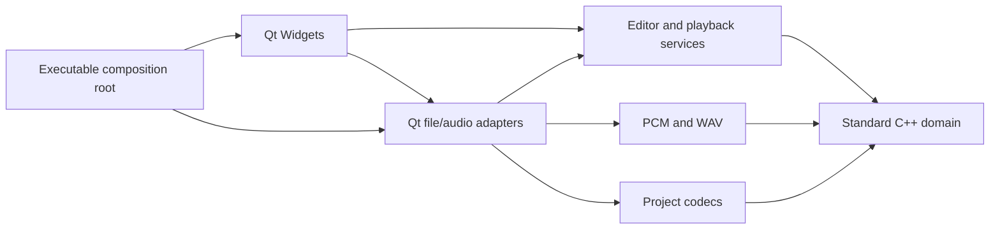
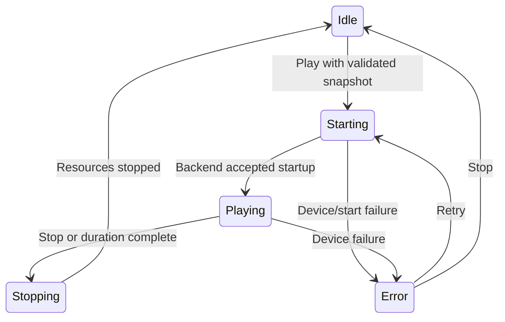

# Architecture

## Dependency rules

`vibmory_domain`, `vibmory_application`, `vibmory_audio`, and `vibmory_persistence` compile without Qt. The platform adapter connects codecs/renderers to Qt files and audio. The UI coordinates user requests through those boundaries. Internal headers live with their modules, with target-scoped include/link requirements. There is no service locator, dependency container, plugin framework, or shared mutable global document.

## State and ownership

- `PatternDocument` owns validated rows/columns, stimulus frames, settings, and explicit channel routing. It has no selected frame/cell, colors, timers, mutexes, file paths, or devices.
- `EditorSession` owns the editable document, selection, monotonic revision, save identity, and bounded undo/redo. Commands apply to a candidate state and publish only after success. Selection changes do not dirty the document.
- `PlaybackService` owns an immutable snapshot and playback state. A backend supplies processed sample position; a monotonic-clock fallback exists for backends without one. A UI timer requests projection updates and never defines elapsed frame count.
- `GridWidget` owns only a one-frame numeric view projection. Geometry uses column=x, row=y and floating cell rectangles, including remainder pixels. Paint events are pure.
- `QtAudioBackend` owns its sink and sequential PCM source. The stream owns a renderer snapshot and serves bounded blocks. Preview has no temporary files and no independently generated stale audio.
- The executable constructs store, backend, clock, and editor in lifetime order. The editor stops playback and cancels/joins its export future before its session is destroyed. Qt parents own child widgets; smart pointers own non-parented sink/stream objects.

The GUI thread owns mutable editor/widgets and Qt audio objects. Export receives a document copy and creates its QSaveFile on a worker. Only atomic progress/cancel values cross the worker boundary. Completion is delivered to the live window by QFutureWatcher. No worker captures a widget or editor reference.

## Playback states

The backend's asynchronous error/completion signals reach the window through queued connections. Buttons reflect state, not the other way around. Editing is locked for preview/export; selection is retained for resuming editing. Repeated stop is harmless. There is no temporary-file Ready state because preview streams directly.

## Persistence and compatibility decisions

Qt 6.8 is the minimum GUI baseline; CI builds 6.8.3 on Windows x64. Qt 5's raw QAudioOutput API was removed rather than hidden behind a misleading package selector. The pure core remains standard C++20 so it can be tested without Qt.

The canonical format is deliberately a small versioned text grammar, not permissive ad hoc CSV. It preserves all rendering inputs. Legacy CSV has a dedicated strict reader and an explicit orientation argument. Its column-major audio channel order is preserved in a saved permutation. New documents use row-major channels. A phase policy is saved explicitly so changing frequencies is reproducible.

Saves and exports use QSaveFile with direct-write fallback disabled. Open validates the complete candidate before replacing a working project. Export failure/cancel never commits. Unsaved user changes are guarded on normal New/Open/Close navigation.

## Verification boundaries

Core tests check shape/index/value limits, frame commands, complete codec round trips, malformed input, exact samples/endian/channel mapping, WAV chunks, cancellation, undo/redo/dirty revisions, fake-clock playback and snapshot isolation. Qt Test covers geometry, signal ordering, view refresh purity, widget synchronization, file adapters, and preview editing state. CI's deployed launch removes Qt from PATH. Actual driver support, physical routing and latency require the user's intended hardware.

The original audit remains a historical snapshot; use the implementation tracker for remaining scope and current evidence.
