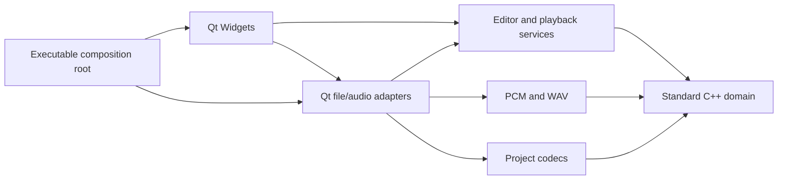
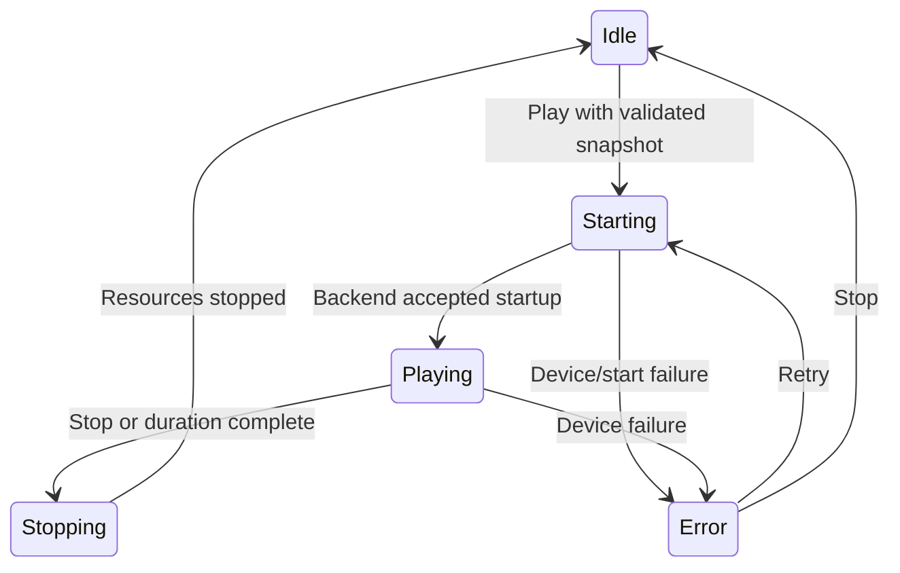

# Architecture

## Dependency rules

`vibmory_domain`, `vibmory_application`, `vibmory_audio`, and `vibmory_persistence` compile without Qt. The platform adapter connects codecs/renderers to Qt files and audio. The UI coordinates user requests through those boundaries. Internal headers live with their modules, with target-scoped include/link requirements. There is no service locator, dependency container, plugin framework, or shared mutable global document.

## State and ownership

- `PatternDocument` owns validated rows/columns, stimulus frames with durable document-scoped identities, settings, and explicit channel routing. It has no selected frame/cell, colors, timers, mutexes, file paths, or devices.
- `EditorSession` owns the editable document, selection, monotonic revision, save identity, and bounded undo/redo. Commands apply to a candidate state and publish only after success. Selection changes do not dirty the document.
- `DocumentWorkflow` owns document publication and saved-revision policy through a storage port. Failed reads never publish; failed saves never clear dirty state. Saving an earlier snapshot cannot mark newer edits as saved.
- `DeviceProfile` validates a reusable grid/routing/gain configuration. Its application operation checks the complete profile and shape before optionally selecting an explicitly requested device and applying an undoable routing command. The Qt store owns bounded JSON and atomic file I/O; the UI action component owns save/load/review dialogs. Profiles do not replace document stimuli or timing.
- `PlaybackService` owns an immutable snapshot and playback state. A backend supplies processed sample position; a monotonic-clock fallback exists for backends without one. A UI timer requests projection updates and never defines elapsed frame count.
- `GridWidget` owns only a one-frame numeric view projection. Geometry uses column=x, row=y and floating cell rectangles, including remainder pixels. Paint events are pure.
- `CellInspector` owns its controls and emits edit intentions. Its programmatic refresh blocks command signals, including transitions back to zero values. The editor applies those intentions through its session.
- `FrameListModel` projects frame IDs, labels, and cached thumbnails into a standard list view. Drag reorder invokes the same transactional session command as move buttons, then publishes Qt row-move notifications. Refresh blocks selection commands. Foreign or stale drag payloads are rejected using a model token and monotonic document revision; a failed command leaves the projection unchanged. Only edited cell values invalidate a thumbnail during ordinary refresh.
- `QtAudioBackend` owns its sink and sequential PCM source. The stream owns a renderer snapshot and serves bounded blocks. Preview has no temporary files and no independently generated stale audio.
- `WaveExportJob` owns the asynchronous export future, cancellation/progress state, and exception boundary. It accepts a snapshot and a replaceable export operation; it never reads mutable UI/session objects. Cancellation preserves the destination through the file adapter's atomic commit.
- `RecoveryController` coordinates background recovery snapshots and explicit startup restoration. It observes document generation/revision and dirty state, owns a process-protected recovery file, and joins old work before save/replacement/close cleanup. A restored session has a new generation and remains dirty. Recovery workers receive immutable copies; the Qt store owns versioned metadata, bounded parsing, atomic writes, and inactive-session retention. No recovery write targets the original project path.
- `UiPreferences` owns presentation settings, application palette, and translator lifetime. The composition root supplies persistent settings for normal launches and temporary settings for automated previews. Theme changes are immediate; language changes are saved for the next launch, so existing editor widgets and commands are not reconstructed. Preferences never enter domain state or project serialization. Standard Qt icons remain paired with visible labels.
- The executable constructs store, backend, clock, exporter, and editor in lifetime order. The editor stops playback and cancels/joins its export job before its session is destroyed. Qt parents own child widgets; smart pointers own non-parented sink/stream objects.

The GUI thread owns mutable editor/widgets and Qt audio objects. Export and recovery receive document copies and create their QSaveFile on workers. Only atomic progress/cancel values cross the worker boundary. Jobs receive QFutureWatcher completion on the GUI thread. No worker captures a widget or editor reference. Audio callbacks carry a generation token so queued notifications from a stopped session cannot terminate a newer one.

## Playback states

The backend's asynchronous error/completion signals reach the window through queued connections. Buttons reflect state, not the other way around. Editing is locked for preview/export; selection is retained for resuming editing. Repeated stop is harmless. There is no temporary-file Ready state because preview streams directly.

## Persistence and compatibility decisions

Qt 6.8 is the minimum GUI baseline; CI builds 6.8.3 on Windows x64. Qt 5's raw QAudioOutput API was removed rather than hidden behind a misleading package selector. The pure core remains standard C++20 so it can be tested without Qt.

The canonical format is deliberately a small versioned text grammar, not permissive ad hoc CSV. Version 2 preserves frame identities and the allocation counter alongside all rendering inputs; the reader also accepts version 1 and assigns sequential identities. Legacy CSV has a dedicated strict reader and an explicit orientation argument. Its column-major audio channel order is preserved in a saved permutation. New documents use row-major channels. A phase policy is saved explicitly so changing frequencies is reproducible.

Saves and exports use QSaveFile with direct-write fallback disabled. Open validates the complete candidate before replacing a working project. Export failure/cancel never commits. Unsaved user changes are guarded on normal New/Open/Close navigation.

## Verification boundaries

Core tests check shape/index/value limits, frame commands, complete codec round trips, malformed input, exact samples/endian/channel mapping, WAV chunks, cancellation, undo/redo/dirty revisions, fake-clock playback, snapshot isolation, and failure/revision behavior through a fake storage port. Qt Test covers geometry/keyboard bounds, signal ordering, view refresh purity, device-selection preservation, widget synchronization, file adapters, modal close/save failures, worker exceptions/cancel/restart, and shutdown ownership. CI's deployed launch removes Qt from PATH and checks app-local compiler DLLs. Actual driver support, physical routing and latency require the user's intended hardware.

Formatting and include-direction checks run for all owned C++ sources. Clang-Tidy analyzes the actual core compilation database using pinned LLVM 21.1.0. Sanitizer builds and independent WAV decoding complement analysis; no one check establishes all behavior.

The original audit remains a historical snapshot; use the implementation tracker for remaining scope and current evidence.
