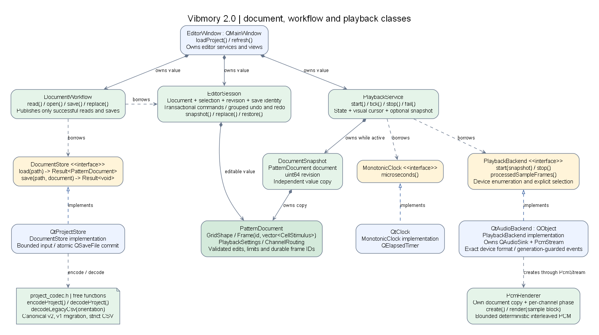
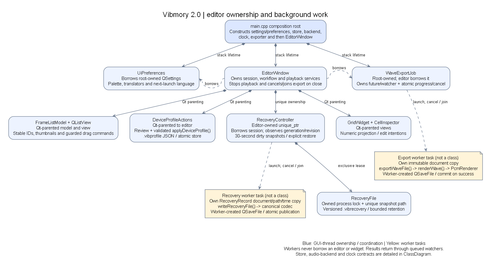

# Current class and lifecycle diagrams

These diagrams describe the Vibmory 2.0 implementation. They replace the old window/controller/helper diagram. The maintained Graphviz `.dot` files are the image sources; PNG previews and scalable SVGs are generated from them. Selected responsibilities and methods are shown rather than every field or framework base class.

## Production targets


[Scalable SVG](Architecture.svg) · [Graphviz source](Architecture.dot)

Arrows point from a consumer to a direct production target dependency in the root `CMakeLists.txt`. Green nodes compile without Qt; blue nodes form the desktop integration. Compiler-options, framework, test and benchmark targets are omitted. There is no dependency from the core back into the UI or Qt adapters.

## Document, workflows and playback



[Scalable SVG](ClassDiagram.svg) · [Graphviz source](ClassDiagram.dot)

- A filled diamond is at the owner of a value/resource. Each owned `PatternDocument` is a separate value, not a shared mutable document.
- A dashed arrow labeled **borrows** is a non-owning service/reference dependency.
- A dashed arrow with an open triangle points from an implementation to its interface. `DocumentStore`, `PlaybackBackend`, and `MonotonicClock` have virtual destructors and support test fakes.
- The note-shaped codec node contains free functions. There is no `ProjectCodec` class. WAV encoding also uses free functions around `PcmRenderer`.

`EditorWindow` owns its `EditorSession`, `DocumentWorkflow`, and `PlaybackService` values. `DocumentWorkflow` borrows the session and a root-owned store. `PlaybackService` borrows a root-owned backend and clock and owns a snapshot while playing. `QtAudioBackend` creates an owned `PcmStream`, which owns a renderer/document copy; a separate owned `QAudioSink` pulls its PCM bytes. The renderer never borrows the editor's live document.

`PatternDocument` owns a grid shape, frames with durable identities and row-major `CellStimulus` vectors, validated `PlaybackSettings`, and explicit `ChannelRouting`. It contains no colors, file paths, device objects, selection or timers. `EditorSession` separately owns selected frame/cell, monotonic revision/document generation, save identity/path, and bounded grouped undo/redo.

## Editor ownership, export and recovery



[Scalable SVG](EditorLifecycle.svg) · [Graphviz source](EditorLifecycle.dot)

Blue objects are owned/coordinated on the GUI thread. Yellow notes represent worker tasks, not additional classes. The composition root constructs dependencies before the editor, so borrowed stores, output devices, clock, preferences and export job outlive the editor. Qt parenting owns child views/actions/models; the editor exclusively owns its recovery controller.

| Component | Current role and lifecycle |
| --- | --- |
| `GridWidget` / `GridGeometry` | One numeric frame projection; shared floating geometry for painting and hit testing; bounded keyboard/mouse selection. Painting does not advance playback. |
| `CellInspector` | Frequency/amplitude controls emit edit intentions. Signal-blocked refresh cannot issue a command or dirty the document. |
| `FrameListModel` / `QListView` | Labels, durable IDs and cached thumbnails. Dragging calls the session move command; model token/revision checks reject foreign or stale drags. |
| `DeviceProfileActions` / `DeviceProfile` | Save/load/review `.vibprofile` values. `applyDeviceProfile()` validates shape/routing/gains and changes the physical device only on explicit selection. Document routing changes are undoable. |
| `UiPreferences` | Borrows root-owned `QSettings`; owns palette/translator state. Themes change immediately; language changes apply next launch without replacing the document. |
| `WaveExportJob` | Borrows no editor state. A copied snapshot goes to a worker running `exportWaveFile()` / `renderWave()`. It owns future/watcher and atomic cancel/progress state; shutdown cancels and joins. |
| `RecoveryController` / `RecoveryFile` | The controller borrows the session and owns a locked, session-specific recovery file. Workers receive a `RecoveryRecord` copy. Save/replacement/accepted close cancel/join work before clearing the owned snapshot. |

Project saves use `QtProjectStore` and checked atomic writes. WAV export creates its `QSaveFile` on the export worker, uses the same PCM renderer as preview, and commits only after successful rendering. Recovery uses a separate versioned file and never automatically overwrites the last explicitly saved project. Workers deliver completion through queued watchers; no worker captures a widget or mutable session reference.

See [Architecture](../Architecture.md) for the playback state diagram and contracts, [Project format](../ProjectFormat.md) for v2/v1/legacy compatibility and phase/routing rules, [Device profiles](../DeviceProfiles.md), and [Recovery](../Recovery.md) for retention/restore behavior.

## Regenerate and review

Install Graphviz so that `dot` is on PATH, then run from the repository root:

```powershell
python tools/render_diagrams.py
```

This updates all three PNG/SVG pairs from their `.dot` files, including the README overview and the existing `ClassDiagram.png` path. To validate rendering without changing the tracked previews:

```powershell
python tools/render_diagrams.py --output-dir out/diagrams
```

Update the DOT source with any related CMake/class/ownership change, regenerate, and visually review the results. Layout/font metrics can vary between Graphviz installations; the DOT relationships are authoritative. CI renders the sources into `out/diagrams` to catch invalid diagrams, and packaged documentation includes sources and previews.
